# Boosting the Transferability of Adversarial Examples Through Gradient Aggregation

## 核心信息

- 标题: Boosting the Transferability of Adversarial Examples Through Gradient Aggregation
- 标题翻译: 通过梯度聚合提升对抗样本的可迁移性
- 作者: Fuquan Gan (甘富全), Yan Wo (沃焱)
- 机构: 华南理工大学计算机科学与工程学院
- 发表时间: 2025年5月29日 (published), IEEE TIFS Vol. 20, 2025
- 发表渠道: IEEE Transactions on Information Forensics and Security (TIFS)
- DOI: 10.1109/TIFS.2025.3574989
- 论文链接: https://doi.org/10.1109/TIFS.2025.3574989
- 代码 / 项目: 未提供
- 数据 / 资源: ImageNet-compatible dataset (NIPS 2017 adversarial attack competition)
- 论文类型: 对抗攻击方法 (transfer-based black-box attack)

## 原文摘要翻译

深度神经网络已被证明容易受到精心设计的对抗样本的攻击。基于迁移的攻击不需要获取目标模型的信息，已成为 DNN 在实际场景中部署的重大威胁。尽管已有大量工作从不同角度提升对抗样本的可迁移性，但可迁移性仍然不够理想。本文提出一种新颖的基于迁移的攻击方法，称为梯度聚合攻击（Gradient Aggregation Attack, GAA）。受"更平坦的局部极小值可以提升可迁移性"这一观察的启发，GAA 将最坏感知损失（worst-aware loss）和替代间隙损失（substitute gap loss）同时纳入目标函数。***最坏感知损失表示对抗样本邻域内的最大损失值，而替代间隙损失则量化最坏感知损失与经验损失之间的差异，作为局部极小值区域平坦性的度量***。通过同时优化经验损失和这两种损失，GAA 能够在平坦的局部极小值区域内生成对抗样本，同时进一步增强其平坦性，最终超越所有基线方法。具体而言，由于直接优化最坏感知损失在对抗样本生成过程中会带来大量计算开销，我们使用一阶泰勒展开来近似最坏感知损失以降低计算代价。严格的理论分析和大量实验表明，我们提出的 GAA 方法生成的对抗样本对应于更平坦的局部极小值区域。与现有的基于迁移的攻击方法相比，GAA 有效提升了对抗样本的可迁移性，无论模型是正常训练还是采用了先进的防御机制。

## 创新点

1. **替代间隙损失（Substitute Gap Loss）**：将替代间隙定义为最坏感知损失与经验损失之差 $h(x', y_t; \theta) = L_w - L$，并通过二阶泰勒展开证明 $h \approx \frac{1}{2}\rho^2 \sigma_{\max}$（$\sigma_{\max}$ 为 Hessian 矩阵最大特征值），从而建立了替代间隙与损失景观平坦性之间的定量关系。这是一个理论上优雅的平坦性度量，相比 PGN 的一阶梯度范数惩罚更具理论深度。

2. **三种损失联合优化的 GAA 框架**：将经验损失（保证对抗样本本身损失最小）、最坏感知损失（迫使邻域内所有点损失均匀低）、替代间隙损失（显式最小化曲率）三者统一纳入同一优化目标 $\min L + L_w + \lambda h$，通过梯度聚合实现三种梯度方向的协同，而不是像 RAP 或 PGN 那样仅依赖单一机制。

3. **最坏感知损失的一阶泰勒高效近似**：通过求解 $\tau^* \approx \rho \cdot \frac{\nabla L}{\|\nabla L\|_1}$，将邻域搜索的高复杂度降低为仅需一次额外前向传播，在略微牺牲攻击成功率的前提下大幅降低了内存占用和运行时间（Table IX），使方法在实践中可行。

4. **充分的理论分析**：对替代间隙损失为何能度量平坦性（Sec. III-D）以及 GAA 优化目标为何能提升可迁移性（Sec. III-E）均给出了从一阶/二阶泰勒展开出发的严谨推导，揭示了目标函数中同时包含一阶梯度和二阶曲率信息是 GAA 优于纯一阶方法的关键原因。

## 一句话总结

GAA 通过同时优化经验损失、最坏感知损失和替代间隙损失，将对抗样本引导至更平坦的局部极小值区域，在不需要额外模型查询的前提下，相比 RAP、PGN 等强基线在多种模型架构（CNN、Transformer、对抗训练模型、先进防御模型）上取得了一致且统计显著的迁移性提升。

---

## 问题背景与动机

### 基于迁移的黑盒攻击

在实际场景中，攻击者通常无法获取目标模型的架构和参数，因此基于迁移的黑盒攻击成为评估 DNN 鲁棒性的重要手段。其核心流程是：在已知的白盒代理模型上生成对抗样本，然后将其迁移到未知的黑盒目标模型上进行攻击。这一过程可形式化为：

$$\min_{x^{adv} \in B_\epsilon(x)} L(x^{adv}, y_t; F), \quad \text{使得} \quad M(x^{adv}) = y_t \quad \text{(目标攻击)}$$

其中 $F$ 为代理模型，$M$ 为未知的目标模型。

可迁移性的核心瓶颈在于对抗样本容易**过拟合到代理模型的特定损失景观**，形成尖锐的局部极小值，导致在目标模型上表现不佳。

### 平坦局部极小值与可迁移性

近年来的研究（如 RAP、PGN）从模型泛化理论中获得启发——更平坦的局部极小值通常意味着更好的泛化能力——试图通过引导对抗样本落在平坦的局部极小值区域来提升可迁移性。然而，作者通过实证分析指出：

- RAP 仅优化最坏情况扰动方向，缺乏对平坦性的显式度量
- PGN 通过惩罚梯度范数（一阶）来促进平坦性，但一阶信息不足以完整刻画曲率

两者的对抗样本要么平坦性不够，要么未真正落在局部极小值区域。下图清晰展示了这一差距：

![[Papers/Adversarial-Attacks/2025_GAA/images/1_fig1.jpg]]
*Fig. 1: 不同攻击方法生成的对抗样本在代理模型（Inc-v3）上的损失轮廓可视化。沿两个随机方向采样，颜色越深表示损失值越低，范围越大表示区域越平坦。GAA 生成的对抗样本展现出比 RAP 和 PGN 更平坦的局部极小值区域。*

### 本文的核心洞察

作者提出，理想的对抗样本应满足三个条件：

1. **条件 i)**：对抗样本自身达到最小损失值（经验损失优化）
2. **条件 ii)**：对抗样本邻域内的所有点呈现均匀的最小损失值（最坏感知损失约束）
3. **条件 iii)**：对抗样本所处区域的平坦性可被有效度量并达到最优值（替代间隙损失约束）

求解目标：
$$\displaystyle \min_{x' \in B_{\epsilon}(x)} L(x', y_t; \theta) + L_w(x', y_t; \theta) + \lambda h(x', y_t; \theta)$$

To fulfill these conditions, we optimize ***the empirical loss*** to ensure that the adversarial example itself attains the minimal loss. We use ***the worst-aware loss***, which is the maximum loss value of the neighborhood points of the adversarial example. By optimizing this loss, we enforce a uniform minimal loss within the adversarial neighborhood. To effectively quantify the flatness, we introduce ***the substitute gap loss***. Through Taylor expansion analysis, we demonstrate that the substitute gap loss can measure flatness, and optimizing this loss function effectively enhances the flatness of the region surrounding the adversarial example.

---

## 方法主线

### 形式化定义

给定代理模型 $F$ 参数化为 $\theta$，干净图像 $x$ 对应真实标签 $y$，扰动预算 $\epsilon$，对抗样本 $x^{adv} \in B_\epsilon(x) = \{x' : \|x' - x\|_p \leq \epsilon\}$。基于迁移的对抗攻击目标为公式 (1)（目标攻击）或公式 (2)（非目标攻击）。

### 机制流程

GAA 的完整生成流程可分解为以下四个步骤：

**步骤 1 — 经验损失梯度计算**：对当前对抗样本的 $\xi$-球邻域内随机采样的 $N$ 个点，计算其经验损失梯度 $g' = \nabla_{x'} L(x', y_t; \theta)$。这一步确保对抗样本自身处于低损失区域，满足条件 i。

**步骤 2 — 最坏感知损失近似**：利用一阶泰勒展开求解邻域内最大损失的方向扰动 $\hat{\tau} \approx \rho \cdot \frac{g'}{\|g'\|_1}$（由 Hölder 不等式推导），在 $x'$ 上施加该扰动得到 $\hat{x} = x' + \hat{\tau}$，并计算 $\hat{x}$ 处的经验损失梯度 $\hat{g} = \nabla_{\hat{x}} L(\hat{x}, y_t; \theta)$。这一步近似了邻域内最坏情况下的损失梯度，满足条件 ii。

**步骤 3 — 梯度聚合**：将三种梯度按权重聚合为统一更新方向：
$$g' = \hat{g} + (1 - \lambda)g' + (1 + \lambda)\hat{g}$$
这一聚合方式对应目标函数 $\min (1-\lambda)L(x') + (1+\lambda)L(x' + \hat{\tau})$ 的梯度，等价于同时优化经验损失、最坏感知损失和 $\lambda$ 倍的替代间隙损失。

**步骤 4 — 动量更新与投影**：对 $N$ 次采样的梯度取平均以降低方差，使用增强动量 $g_{t+1} = \mu g_t + g / \|g\|_1$ 稳定更新方向，最后通过符号梯度更新并投影回 $\epsilon$-球内：
$$x^{adv}_{t+1} = \text{clip}_{x,\epsilon}\left(x^{adv}_t + \alpha \cdot \text{sign}(g_{t+1})\right)$$

![[Papers/Adversarial-Attacks/2025_GAA/images/2_fig2.jpg]]
*Fig. 2: 不同攻击方法的梯度方向示意。蓝色 $\nabla f$ 为经验损失梯度（I-FGSM），绿色 $\nabla f_w$ 为最坏感知损失梯度（近似 RAP），棕色 $\nabla f_{PGN}$ 为 PGN 的梯度正则化方向，红色 $\nabla f_{Ours}$ 为 GAA 聚合三种梯度后的更新方向。灰色虚线框表示理想的平坦局部极小值区域。*

### 最坏感知损失的泰勒近似

直接优化最坏感知损失 $L_w(x', y_t; \theta) = \max_{\|\tau\|_\infty \leq \rho} L(x' + \tau, y_t; \theta)$ 需要在邻域内进行大量搜索，计算代价高昂。作者通过对 $L(x' + \tau)$ 在 $x'$ 处做一阶泰勒展开：

$$\tau^* = \arg\max_{\|\tau\|_\infty \leq \rho} \nabla_{x'} L(x')^T \tau$$

利用 Hölder 不等式（$p=1, q=\infty$ 对偶），当 $\nabla L$ 与 $\tau$ 同方向且 $\tau$ 取边界值时等号成立，$\rho$为采样邻域半径，解得：

$$\hat{\tau} \approx \rho \cdot \frac{\nabla L(x', y_t; \theta)}{\|\nabla L(x', y_t; \theta)\|_1}$$

代入公式 (5) 后得到最终优化目标：

$$\min_{x' \in B_\epsilon(x)} (1-\lambda)L(x', y_t; \theta) + (1+\lambda)L\left(x' + \rho\frac{\nabla L}{\|\nabla L\|_1}, y_t; \theta\right)$$

该近似虽然在计算 $\hat{x}$ 处的损失时隐式涉及 Hessian-vector 积，但可通过自动微分直接计算，无需显式构建 Hessian 矩阵。

### 替代间隙损失的理论分析

Optimizing the worst-aware can find a region with a low loss value, but it does not necessarily guarantee flatness [43], while the substitute gap can enhance the flatness of the local region.
[43] J. Zhuang et al., “Surrogate gap minimization improves sharpnessaware training,” in Proc. Int. Conf. Learn. Represent. (ICLR), Jan. 2022, pp. 1–24.

The substitute gap represents the difference between the worst-aware loss and the empirical loss.
$$\displaystyle h(x', y_t; \theta) = L_w(x', y_t; \theta) - L(x', y_t; \theta)$$

本节是全文理论最核心的部分。作者通过二阶泰勒展开建立了替代间隙与损失景观平坦性之间的等价关系。

对 $L(x' + \tau)$ 在 $x'$ 处做二阶展开：
$$\begin{align*} \max_{\|\tau\|_\infty \le \rho} L(x' + \tau, y_t; \theta) &= \max_{\|\tau\|_\infty \le \rho} L(x', y_t; \theta) + \nabla L(x', y_t; \theta)^T \tau + \frac{1}{2}\tau^T H \tau + \mathcal{O}(\tau^3) \\ &\approx \max_{\|\tau\|_\infty \le \rho} L(x', y_t; \theta) + \nabla L(x', y_t; \theta)^T \tau + \frac{1}{2}\tau^T H \tau \end{align*}$$

$$\max_{\|\tau\|_\infty \leq \rho} L(x' + \tau) \approx L(x') + \max_{\|\tau\|_\infty \leq \rho} \left[\nabla L(x')^T \tau + \frac{1}{2}\tau^T H \tau\right]$$

在局部极小值处 $\nabla L(x') = 0$，因此：

$$L_w(x') \approx L(x') + \frac{1}{2}\rho^2 \sigma_{\max}$$

其中 $\sigma_{\max}$ 为 Hessian 矩阵 $H$ 的最大特征值，而 $\sigma_{\max}$ 的大小直接衡量损失景观的陡峭程度——$\sigma_{\max}$ 越大，区域越尖锐。

于是替代间隙损失可重写为：

$$h(x') = L_w - L \approx \frac{1}{2}\rho^2 \sigma_{\max} \geq 0$$

这意味着，**对于固定的搜索半径 $\rho$，替代间隙损失 $h$ 与平坦性度量 $\sigma_{\max}$ 成正比**。最小化 $h$ 等价于最小化 $\sigma_{\max}$，即显式地迫使损失景观变得更加平坦。

此外，作者以一阶展开推导了替代间隙的非负性：$h(x') \approx \rho\|\nabla L(x')\|_1 \geq 0$。
：一阶泰勒展开
$$\begin{align*} \max_{\|\tau\|_\infty \le \rho} L(x' + \tau, y_t; \theta) &= \max_{\|\tau\|_\infty \le \rho} L(x', y_t; \theta) + \nabla L(x', y_t; \theta)^T \tau + \mathcal{O}(\tau^2) \\ &\approx \max_{\|\tau\|_\infty \le \rho} L(x', y_t; \theta) + \nabla L(x', y_t; \theta)^T \tau \\ &\approx L(x', y_t; \theta) + \rho \left\| \nabla L(x', y_t; \theta) \right\|_1 \end{align*}$$

![[Papers/Adversarial-Attacks/2025_GAA/images/3_fig3.jpg]]
*Fig. 3: 尖锐局部极小值 $x_1^{adv}$（红色）与平坦局部极小值 $x_2^{adv}$（蓝色）的对比。实线为经验损失 $L$，虚线为最坏感知损失 $L_w$。虽然 $x_1^{adv}$ 的 $L_w$ 更小，但其替代间隙 $h(x)$ 更大（区域更尖锐）；$x_2^{adv}$ 的 $h(x)$ 更小（区域更平坦）。替代间隙是比最坏感知损失更可靠的平坦性指标。*

### GAA 优化目标的可迁移性分析

将最坏感知损失的一阶展开 $L_w \approx L + \max \nabla L^T \tau$ 和二阶展开 $L_w \approx L + \max[\nabla L^T \tau + \frac{1}{2}\tau^T H \tau]$ 代入 GAA 目标函数后，得到：

$$\min_{x'} \left[2L + \max_{\|\tau\|_\infty \leq \rho}\left((1+\lambda)\nabla L^T \tau + \frac{\lambda}{2}\tau^T H \tau\right)\right]$$

该形式的精妙之处在于：**目标函数同时包含一阶梯度项（$\nabla L^T \tau$）和二阶 Hessian 项（$\tau^T H \tau$）**。一阶梯度指示损失景观的平坦趋势，但不足以保证区域真正平坦；二阶曲率信息能够更准确地捕捉损失景观的曲率变化，避免优化陷入尖锐局部极小值。作者引用了 Fan et al. [32] 的理论结果——仅优化一阶梯度和确保二阶梯度的参与都是提升可迁移性的必要条件——来支撑 GAA 设计的合理性。

[32] M. Fan, X. Li, C. Chen, W. Zhou, and Y. Li, “Transferability bound theory: Exploring relationship between adversarial transferability and flatness,” in Proc. Adv. Neural Inf. Process. Syst., vol. 37, 2024, pp. 41882–41908.

---

## 实验

### 实验设置

| 配置项                | 详情                                                                       |
| ------------------ | ------------------------------------------------------------------------ |
| 数据集                | ImageNet-compatible dataset (NIPS 2017), 1000张, 299×299×3                |
| 代理模型 (非目标)         | Inc-v3, Inc-v4, IncRes-v2, Res-101                                       |
| 代理模型 (目标)          | Inc-v3, Res-50, DenseNet-121, VGG-16bn                                   |
| 目标模型 (CNN)         | Inc-v3, Inc-v4, IncRes-v2, Res-101, Res-152                              |
| 目标模型 (Transformer) | DeiT, Visformer, PiT, Swin                                               |
| 目标模型 (异架构)         | MobileNetv2, Xception, Twins-SVT-B, ViT-B/32, MLP-Mixer                  |
| 防御模型 (对抗训练)        | Inc-v3_adv, Inc-v3_ens3, Inc-v3_ens4, IncRes-v2_ens                      |
| 防御模型 (先进)          | AT, HGD, RS, NRP, DiffPure                                               |
| 扰动预算               | $\epsilon = 16.0/255$, $T = 10$ (非目标) / $T = 400$ (目标)                   |
| GAA 超参数            | $N = 20$, $\lambda = 0.2$, $\xi = 3.5 \times \epsilon$, $\rho = 1.6/255$ |

### 正常训练模型上的非目标攻击
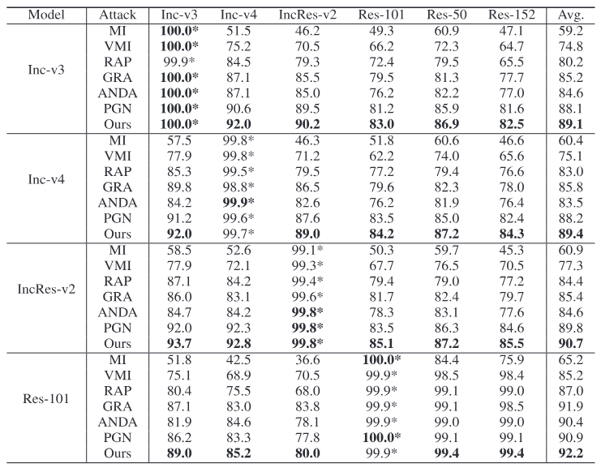
**Table I** 给出了以 Inc-v3 为代理模型时各方法在关键目标模型上的非目标攻击成功率（完整数据请参见原论文 Table I）。核心发现：

- 以 Inc-v3 为代理模型时，GAA 在 Inc-v4 上达到 92.0% 成功率，比最强基线 PGN 高出约 7.5 个百分点，比同样以平坦区域为目标的 RAP 高出 7.5 个百分点
- 在白盒场景下，GAA 接近完全攻击成功（~99%），说明 GAA 并不以牺牲白盒性能为代价获取黑盒迁移性
- 与 RAP 和 PGN 的对比进一步验证了作者的核心主张：更平坦的局部极小值区域直接带来更高的可迁移性

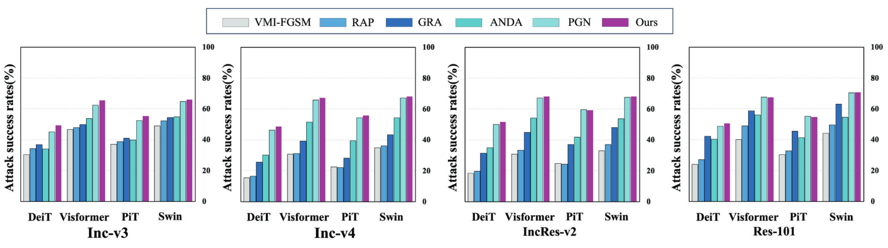
*Fig. 4: 在 DeiT、Visformer、PiT、Swin 四个 Transformer 架构上的攻击成功率。GAA 在所有四个模型上持续优于所有基线。*

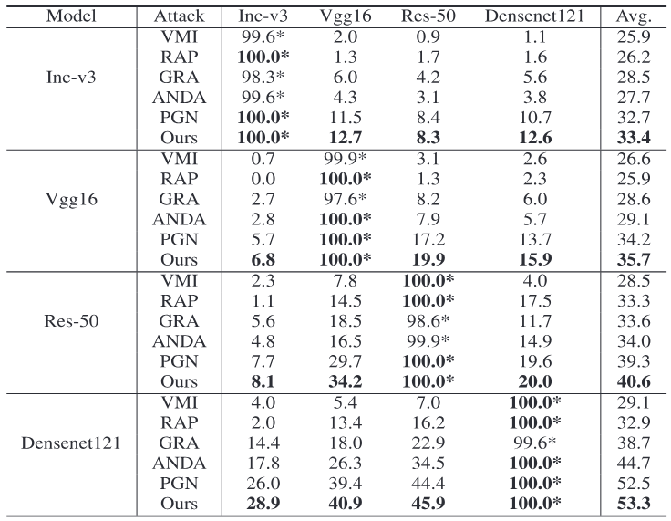
**Table II — 目标攻击**：目标攻击场景下（Table II），使用 VGG-16 为代理模型时，GAA 相比 PGN 平均提升 1.5%，相比 VMI 平均提升 9.1%，表明在更难的目标攻击场景下，平坦性优化依然有效。

### 防御模型评估
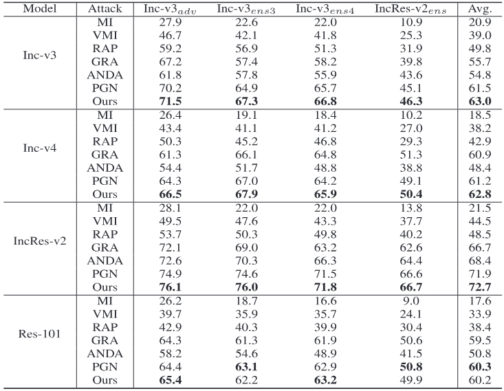
**对抗训练模型 (Table III)**：即使在经过对抗训练的鲁棒模型上，GAA 依然保持领先。以 Inc-v3 为代理模型时，GAA 的平均攻击成功率比 MI 高出 42.1 个百分点，比 PGN 高出 1.5 个百分点。

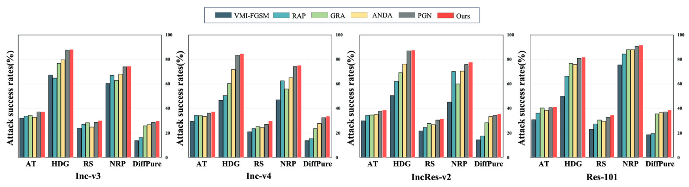
*Fig. 5: 在 AT、HGD、RS、NRP、DiffPure 五种先进防御模型上的攻击成功率。GAA 始终表现最优。*

**先进防御模型 (Fig. 5)**：在 AT、HGD、RS、NRP、DiffPure 五种专门设计的防御机制下，GAA 始终表现最优，其攻击成功率大幅领先于所有基线。这一结果不仅验证了 GAA 的攻击能力，也揭示了当前防御模型在应对基于平坦性优化的迁移攻击时仍存在不足。

### 集成模型与输入变换兼容性
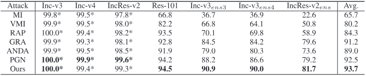
**集成模型 (Table IV)**：当同时攻击 Inc-v3 + Inc-v4 + IncRes-v2 三个代理模型的集成时，GAA 在黑盒目标模型上的平均攻击成功率分别比 MI、VMI、RAP、GRA、ANDA、PGN 高出 28.0%、13.5%、9.4%、2.5%、4.7%、1.2%。值得注意的是，虽然白盒场景下 GAA 在 Inc-v4 和 IncRes-v2 上有轻微下降，但这种"牺牲"换来了黑盒迁移性的大幅提升。

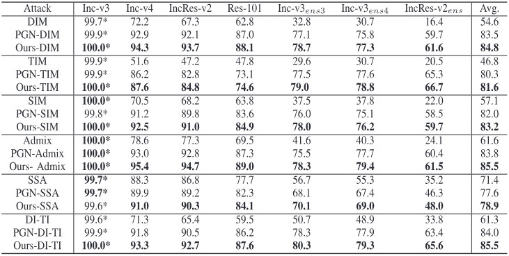
**输入变换兼容性 (Table V)**：GAA 与 DIM、TIM、SIM、Admix、SSA 以及 DIM+TIM 的组合均可无缝集成，集成后进一步超越使用相同变换的 PGN。这验证了 GAA 作为一种梯度层面的方法，与数据增强层面的方法是正交且互补的。

### 跨架构泛化 (Table VI)
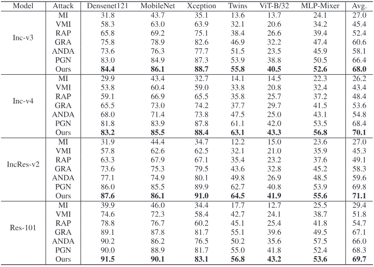
在 DenseNet121、MobileNetv2、Xception、Twins-SVT-B、ViT-B/32、MLP-Mixer 六种不同架构上，以 IncRes-v2 为代理模型时，GAA 达到 71.1% 的平均成功率，比 PGN 高 1.3%，比 RAP 高 22.0%，比 MI 高 44.1%。这说明平坦局部极小值区域能够有效缓解对特定模型架构结构的过拟合。

### 统计显著性检验 (Table VII)
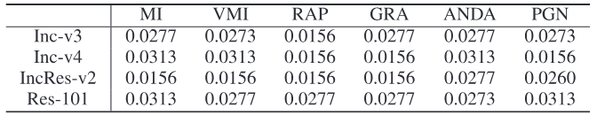
作者采用 Wilcoxon 符号秩检验对所有基线方法进行了配对比较，所有 p 值均小于显著性水平 $\alpha = 0.05$，表明 GAA 的性能提升具有统计显著性。

### 消融实验

**平衡系数 $\lambda$ (Fig. 6, 原论文 p.11 左列)**：$\lambda$ 控制替代间隙损失在目标函数中的权重。$\lambda$ 从 0 增加到 0.2 时，迁移性持续提升；$\lambda > 0.2$ 后开始下降。这揭示了平坦性优化与对抗样本有效性之间的权衡——过度关注平坦性会导致对抗样本偏离局部极小值区域。

**采样邻域上界 $\xi$ (Fig. 7, 原论文 p.11 右列)**：$\xi = 3.5 \times \epsilon$ 时达到最优。$\xi$ 过小则邻域信息利用不足，过大则引入冗余信息。

**采样数量 $N$ (Fig. 8, 原论文 p.11 底部)**：$N = 20$ 时达到性价比最优。$N < 20$ 时梯度方差过高，$N > 20$ 时边际收益递减。

**不同损失组件的贡献 (Table VIII / Fig. 9)**：仅优化经验损失效果最差；加入最坏感知损失后显著提升；三种损失全部优化时达到最佳，且损失轮廓可视化确认了三损失组合生成的对抗样本对应最平坦的损失景观。

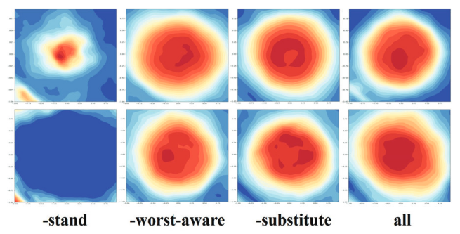
*Fig. 9: 消融实验中不同损失组合的损失轮廓可视化。"-"表示目标函数中不含该项。同时优化三种损失的对抗样本展现出最平坦的损失景观。*

**最坏感知损失近似的效率 (Table IX)**：在 RTX 3090 环境下处理 1000 张图像的对比实验表明，直接优化最坏感知损失的攻击成功率最高，但计算内存和运行时间显著增加；使用一阶泰勒近似后，成功率略有下降，但内存占用大幅降低，运行时间显著缩短。与 MI、VMI 等轻量方法（低开销但迁移性不足）和 RAP、PGN 等方法相比，GAA（近似版）在计算效率与攻击成功率之间取得了最优平衡。

### 可视化分析

**对抗样本可视化 (Fig. 10)**：随机选取的 10 张原始图像及其 GAA 对抗样本显示，在 $\epsilon = 16.0/255$ 的扰动预算下，对抗扰动对人眼几乎不可感知。

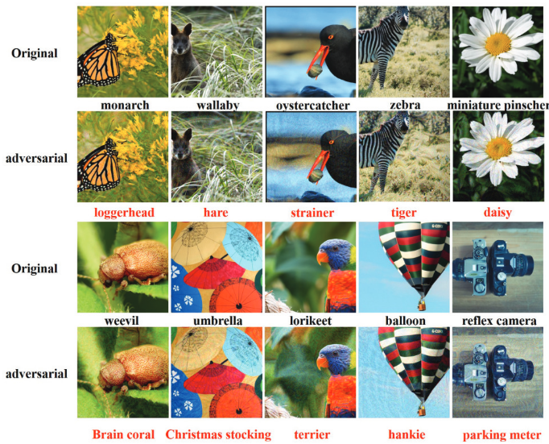
*Fig. 10: 随机选取的原始图像（上排）及其 GAA 生成的对抗样本（下排），扰动几乎不可感知。*

**模型注意力偏移 (Fig. 11)**：通过 Grad-CAM 可视化，GAA 生成的对抗样本导致模型的注意力从主要物体区域大幅偏移到不相关的图像区域，偏移程度远超基线方法。这为 GAA 的高迁移性提供了直观的行为解释——它从根本上干扰了模型的注意力机制，而不仅仅是对特定架构的特征空间进行过拟合。

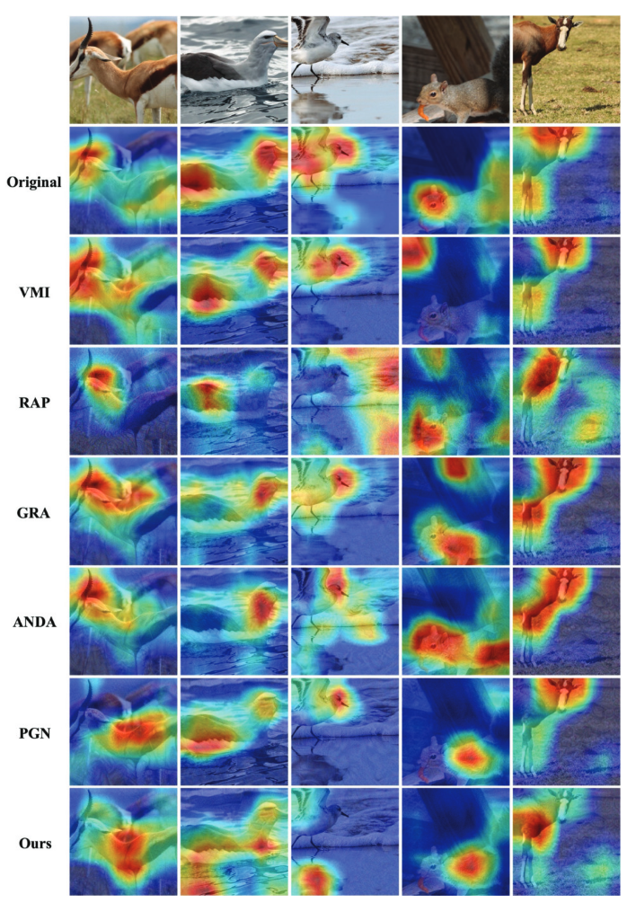
*Fig. 11: 不同攻击方法的 Grad-CAM 注意力对比。GAA 使模型注意力从主体目标显著偏移至无关区域，偏移程度大于所有基线方法。*

---

## 讨论与局限

### 值得关注的局限性

1. **平坦性-可迁移性连接仍是经验性的**：虽然 $\sigma_{\max} \propto h$ 在理论上成立，但从 Hessian 平坦性到跨模型可迁移性的因果关系缺乏严格证明。作者在结论中也承认这是未来的研究方向。

2. **泰勒近似的误差未量化**：一阶近似 $\hat{\tau}$ 忽略了高阶项 $O(\tau^2)$，二阶展开也忽略了 $O(\tau^3)$。当 $\rho$ 较大或损失景观高度非线性时，近似误差可能显著。文中未提供近似精度的定量评估。

3. **超参数敏感性**：$\lambda$、$\xi$、$N$ 三个超参数均需调优，且最优值可能随代理模型、数据集和扰动预算而变化。文中未讨论跨设置的超参数鲁棒性。

4. **单数据集验证**：实验仅在 ImageNet-compatible dataset（1000 张图像）上进行，未在更大规模或不同领域的数据集上验证。

5. **计算开销**：尽管泰勒近似大幅降低了计算量，GAA 仍需在每次迭代中对 $N=20$ 个采样点进行两次前向传播（$x'$ 和 $\hat{x}$），相比 MI-FGSM 等轻量方法仍有额外开销。

### 未来方向

- 建立平坦性与可迁移性之间的理论下界
- 将该方法扩展到非图像领域（语音、文本、视频）
- 探索在 GAA 框架中直接利用 Hessian-vector 积的二阶优化

---

## 参考与引用价值

### 可复用的技术要素

- **替代间隙作为平坦性代理指标**：$h = L_w - L \approx \frac{1}{2}\rho^2\sigma_{\max}$ 是一个计算成本低、仅需梯度信息的平坦性估计量。可用于诊断其他对抗攻击方法的损失景观特征。
- **GAA 的模块化设计**：梯度层面的聚合策略与数据增强层面的输入变换方法（DIM/TIM/SIM/Admix/SSA）完全正交，可即插即用地组合。
- **超参数参考值**：$\lambda \approx 0.2$、$\xi = 3.5\epsilon$、$N = 20$ 可作为复现和调优的起点。

### 关键后续问题

1. 替代间隙指标能否在不运行完整攻击的情况下，仅通过代理模型的局部损失景观特征预测对抗样本的可迁移性？
2. 在更大的扰动预算（$\epsilon > 16/255$）下，GAA 的性能曲线如何变化？平坦性假设是否仍然成立？
3. 能否为平坦性级别与可迁移性之间的正相关关系建立一个理论下界？
4. 是否可以直接在 GAA 框架中引入 Hessian-vector 积计算来替代一阶泰勒近似，从而在不牺牲精度的前提下保持计算效率？
5. GAA 在非图像领域（NLP 对抗文本、语音对抗样本）中的有效性如何？

---

*笔记生成日期: 2026-06-18*
