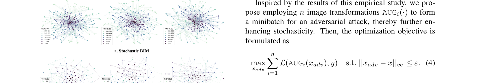
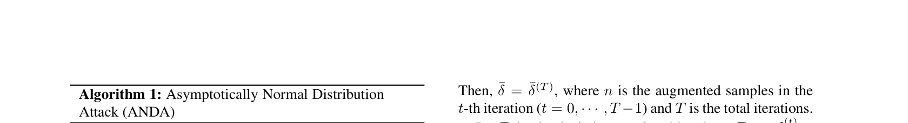
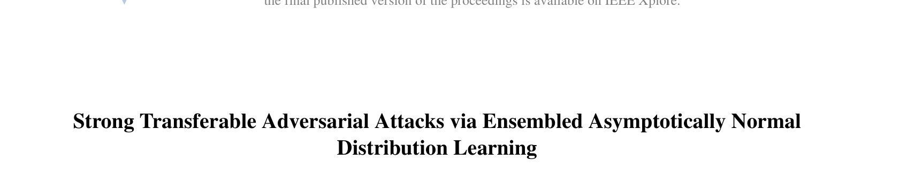
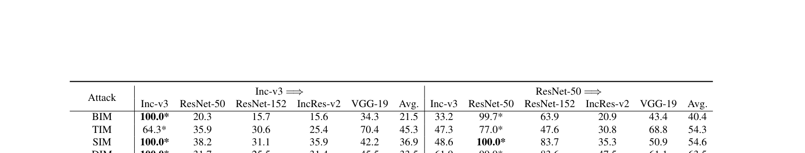
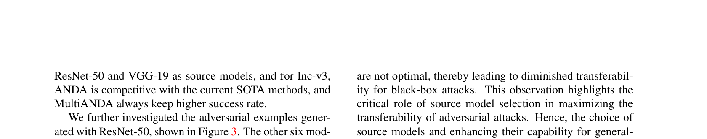
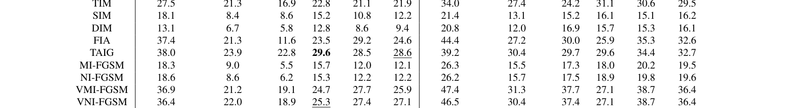
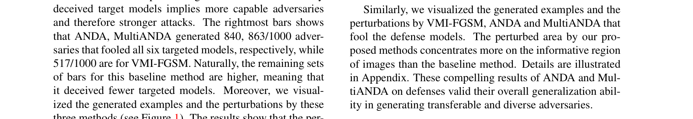

# Strong Transferable Adversarial Attacks via Ensembled Asymptotically Normal Distribution Learning

## 核心信息

- 标题: Strong Transferable Adversarial Attacks via Ensembled Asymptotically Normal Distribution Learning
- 标题翻译: 通过集成渐近正态分布学习实现强可迁移对抗攻击
- 作者: Zhengwei Fang, Rui Wang (通讯), Tao Huang, Liping Jing
- 机构: 北京交通大学计算机科学与技术学院；交通数据分析与挖掘北京市重点实验室；轨道交通安全协同创新中心
- 发表时间: 2024年6月 (CVPR 2024)
- 发表渠道: IEEE/CVF Conference on Computer Vision and Pattern Recognition (CVPR 2024)
- 论文链接: CVPR 2024 proceedings (Open Access)
- 代码 / 项目: https://github.com/CLIAgroup/ANDA
- 数据 / 资源: ImageNet1k (NIPS 2017 competition subset, 1000张)
- 论文类型: 对抗攻击方法（基于贝叶斯推断的迁移攻击）

## 原文摘要翻译

强大的对抗样本对于评估和增强深度神经网络的鲁棒性至关重要。然而，流行攻击方法的性能通常对微小的图像变换敏感，这源于有限的信息——通常仅有一个输入样本、少数白盒源模型和未定义的防御策略。因此，生成的对抗样本容易过拟合源模型，阻碍了它们向未知架构的可迁移性。本文提出了一种名为多重渐近正态分布攻击（MultiANDA）的方法，该方法从学习的分布中显式刻画对抗扰动。具体而言，我们利用随机梯度上升（SGA）的渐近正态性质来近似扰动的后验分布，然后采用深度集成策略作为贝叶斯边缘化的有效代理，旨在估计一个高斯混合分布，促进对潜在优化空间的更彻底探索。近似的后验分布本质上描述了 SGA 迭代的稳态分布，捕捉了局部最优周围的几何信息。因此，MultiANDA 允许为每个输入抽取无限数量的对抗扰动，并可靠地保持可迁移性。我们提出的方法通过在七个正常训练模型和七个防御模型上的大量实验，在带有或不带有防御的深度学习模型上均优于十种最先进的黑盒攻击方法。

## 创新点

1. **首次将 SGD 的渐近正态性理论引入对抗攻击领域**：利用随机梯度上升（SGA）迭代轨迹的渐近正态性质（asymptotic normality），将对抗扰动的生成从确定性优化转变为分布估计问题。通过收集优化轨迹上的前两阶矩（均值和协方差），将对抗扰动的后验分布近似为高斯分布——这一方法论创新从根本上改变了"对抗样本是一个确定的 $x^{adv}$"这一传统认知。

2. **提出 MultiANDA 实现贝叶斯边缘化近似**：通过多次随机初始化 ANDA（每次从原图加随机平移开始），利用深度集成（deep ensemble）策略估计高斯混合分布。每个高斯分量位于不同的吸引盆（basin of attraction），混合模型的多模态效应显著提升了对抗样本的多样性和泛化能力——这是贝叶斯推断理论在对抗攻击中的首次系统性应用。

3. **从分布中采样无限对抗样本的能力**：学习到的扰动分布 $\mathcal{N}(\bar{\delta}, \sigma)$ 允许为每个输入生成任意数量的对抗样本，且采样得到的对抗样本与单次生成样本的攻击成功率相当——这对基于对抗训练的防御策略设计具有重大意义。

4. **从"点的优化"到"分布的估计"的范式转变**：传统方法寻求单一的 $\delta^*$，而 ANDA 估计 $p(\delta | x, y, F)$。这种范式转变使生成的对抗样本不再过拟合源模型的特定损失景观，而是捕捉了局部最优周围的几何结构。

## 一句话总结

ANDA/MultiANDA 开创性地将 SGD 渐近正态性理论引入迁移攻击，从"优化单个扰动"转变为"学习扰动分布"，通过存储 SGA 轨迹的前两阶矩来近似高斯后验，进而从该分布采样任意数量的高可迁移性对抗样本，在防御模型上实现了对现有方法的大幅超越。

---

## 作者的出发点与思路历程

### 问题的发现：传统迁移攻击的本质局限

作者注意到，尽管 MI-FGSM、VMI-FGSM、DIM、TIM、SIM 等方法在正常训练模型上取得了不错的效果，但它们共享一个根本性的局限：**每个输入只生成一个确定的对抗样本**。这种确定性优化过程从一个单点出发，在高维扰动空间中只探索了一条极窄的轨迹，严重限制了探索的充分性。

作者的关键洞察是：PGD 的随机重启（random restart）策略虽然引入了随机性，但其均匀采样点高度集中在自然图像周围（Dong et al. [2020] 指出这一点），缺乏真正的多样性，因而对抗样本的可迁移性仍然有限。

### 核心灵感：SGD 的渐近正态性

作者的思路从 Maddox et al. [2019] 和 Mandt et al. [2017] 的工作中获得启发——这些工作证明了 SGD（在固定且足够小的学习率下）的迭代轨迹会收敛到一个稳态高斯分布，其均值位于局部最优处。这一性质被称为 SGD 的"渐近正态性"（asymptotic normality）。

关键推理链条如下：

1. SGD 迭代 $\theta_{t+1} = \theta_t - \alpha \nabla L_{batch}(\theta_t)$ 在局部最优附近的轨迹近似为一个平稳高斯过程
2. 该高斯过程的均值 $\bar{\theta}$ 是局部最优的无偏估计
3. 协方差矩阵 $\Sigma = \frac{1}{nT-1}DD^T$ 刻画了该高斯分布的扩散范围

作者将这一理论**逆向迁移**到对抗攻击中：SGA（随机梯度上升）的迭代轨迹同样具有渐近正态性质。如果攻击算法引入了足够的随机性（通过数据增强），其生成的扰动序列 $\{\delta^{(0)}, \delta^{(1)}, ..., \delta^{(T-1)}\}$ 将收敛于一个以最优扰动 $\delta^*$ 为均值的高斯分布。

### 为什么选择这种方案？

作者的选择逻辑是：既然单个最优点容易过拟合，而均匀随机采样缺乏多样性，那么最自然的选择就是**估计整个扰动后验分布**，然后从中采样。这本质上是将对抗攻击从 MAP 估计（找最优点）提升为贝叶斯推断（估计完整后验）。MultiANDA 进一步将单峰高斯扩展为多峰高斯混合，通过多个吸引盆覆盖更广泛的优化空间。

---

## 方法主线

### 从确定性 BIM 到随机 BIM

传统 BIM 的迭代更新是确定性的：

$$x_{adv}^{(t+1)} = \Phi\left(x_{adv}^{(t)} + \alpha \cdot \text{sign}\left(\nabla_x \mathcal{L}(x_{adv}^{(t)}, y)\right)\right)$$

其中 $\Phi(\cdot)$ 是 $\epsilon$-球上的投影函数。这个过程从单点出发，没有梯度噪声。

作者通过在每步迭代中引入随机数据增强 $\texttt{AUG}(\cdot)$（如图像平移），将确定性 BIM 改造为随机 BIM：

$$x_{adv}^{(t+1)} = \Phi\left(x_{adv}^{(t)} + \alpha \cdot \text{sign}\left(\nabla_x \mathcal{L}(\texttt{AUG}(x_{adv}^{(t)}), y)\right)\right)$$

这一步的关键作用：数据增强在梯度计算中引入了随机性，使得 SGA 的迭代轨迹满足渐近正态性的前提条件。同时，小常数学习率 $\alpha = \epsilon/T$（对抗攻击的标准设置，$\epsilon$ 很小且 $T$ 通常为 10）恰好满足了 SGD 渐近理论中"足够小的恒定学习率"这一前提。

### 渐近正态性的经验验证

*Fig. 2: (a) 随机 BIM 生成的对抗扰动迭代轨迹的 t-SNE 可视化——300 次迭代、3 张随机 ImageNet 图片，呈现高斯形状分布；(b) ANDA 中 10 次迭代、多种数据增强下的扰动分布——进一步验证了渐近正态性假设。*

作者对随机 BIM 的扰动 $\delta^{(t)}$ 做了 t-SNE 可视化（Fig. 2）。结果显示：

- 300 次迭代的扰动呈明显的高斯形状分布，验证了渐近正态性假设
- 前 10 步已收敛且协方差紧凑——这很重要，因为非目标攻击的标准迭代次数正是 $T=10$
- 使用 sign() 函数和投影操作引入的噪声不影响扰动的收敛性质

### 从分布估计到 ANDA 算法

基于渐近正态性，ANDA 的核心思想是：**不强求解单一的 $\delta^*$，而是估计 $p(\delta | x, y, F)$ 的前两阶矩**。

每次迭代中，使用 $n$ 种数据增强（形成一个小批量 $S$），计算每个增强样本的梯度：

$$\delta_i^{(t)} = \nabla_{x^{(t)}} \mathcal{L}(\texttt{AUG}_i(x_{adv}^{(t)}), y), \quad i = 1, \dots, n$$

根据中心极限定理，小批量上的梯度估计 $\hat{\delta}_S(z)$ 近似服从高斯分布：

$$\hat{\delta}_S(z) \approx \delta(z) + \frac{1}{\sqrt{n}}\Delta\delta(z), \quad \Delta\delta(z) \sim \mathcal{N}(0, C(z))$$

其中 $\delta(z) = \mathbb{E}[\hat{\delta}_S(z)]$ 是全梯度。ANDA 通过迭代平均来估计后验均值：

$$\bar{\delta}^{(t+1)} = \frac{(t \times n)\bar{\delta}^{(t)} + \sum_{i=1}^n \delta_i^{(t)}}{(t+1) \times n}$$

这是对 SGA 所有历史梯度的加权平均，等价于 Polyak-Ruppert 平均（一种降低估计方差的经典技术）。

协方差矩阵通过所有迭代中梯度的偏差来估计：

$$\sigma = \frac{\mathbf{D}\mathbf{D}^T}{n \times T - 1}$$

其中 $\mathbf{D}$ 是偏差矩阵，第 $j$ 列为 $\delta_i^{(t)} - \bar{\delta}^{(t+1)}$（$j = t \times n + i$）。

最终，对抗扰动从学习到的分布中采样：

$$\{\delta_m\}_{m=1}^M \sim \mathcal{N}(\bar{\delta}, \sigma)$$
$$x_{adv}^m = \text{Clip}_{x,\epsilon}\{x^{(T-1)} + \alpha \cdot \text{sign}(\delta_m)\}$$

*Algorithm 1: ANDA 算法完整流程。输入选项 (a) 生成单个对抗样本，选项 (b) 从学习到的分布中采样 $M$ 个对抗样本。*

### MultiANDA：从单峰高斯到高斯混合

ANDA 估计的是以最优 $x^*_{adv}$ 为中心的单峰高斯后验。但单一吸引盆的限制使探索空间仍然局促。MultiANDA 通过执行 $K$ 次 ANDA（每次对原始输入 $x$ 加不同随机初始值），估计 $K$ 个高斯分布，然后取均值的平均：

$$\bar{\delta}_{mean} = \frac{1}{K}\sum_{k=0}^{K-1} \bar{\delta}_k$$

这实现了对贝叶斯后验的多模态近似——每个高斯分量位于不同的吸引盆。Wilson & Izmailov [2020] 的实证研究表明，深度集成（即使仅使用不同随机初始化）可以通过高斯混合的多模态效应显著提升泛化性能。MultiANDA 将这一发现应用于对抗攻击。

*Fig. 1: VMI-FGSM、ANDA 和 MultiANDA 生成的对抗样本扰动可视化。ANDA/MultiANDA 的扰动更集中于物体的语义和决定性区域（如第一行的鸟头部、第二行的人物轮廓），而 VMI-FGSM 的扰动较分散。这是"学习分布而非单点优化"策略在视觉层面的直观体现。*

### 优化目标的统一形式

MultiANDA 的最终优化目标可以统一表述为：

$$\max_{\Pi_\delta} \mathbb{E}_{\delta \sim \Pi_\delta} \sum_{i=1}^n \mathcal{L}(\texttt{AUG}_i(x + \delta), y), \quad \text{s.t. } \|\delta\|_\infty \leq \varepsilon$$

其中 $\Pi_\delta$ 是扰动 $\delta$ 的分布。这一目标是对传统 BIM 目标（最大化单点扰动下的损失）的泛化——当 $\Pi_\delta$ 退化为 Dirac 分布时，它就等价于标准 BIM。

---

## 实验

### 实验设置

| 配置项 | 详情 |
|--------|------|
| 数据集 | ImageNet1k (NIPS 2017 competition subset, 1000张, 299×299) |
| 源模型 (白盒) | Inc-v3, ResNet-50, IncRes-v2, VGG-19 |
| 目标模型 (正常) | Inc-v3, ResNet-50/101/152, Inc-v4, IncRes-v2, VGG-19 |
| 目标模型 (防御) | Inc-v3_ens3/ens4, IncRes-v2_ens, HGD, NRP, RS, NIPS-r3 |
| 对比基线 | BIM, TIM, SIM, DIM, FIA, TAIG, NI-FGSM, MI-FGSM, VMI-FGSM, VNI-FGSM |
| 扰动预算 | $\epsilon = 16/255$（标准 $L_\infty$ 约束） |

### 正常训练模型上的攻击 (Table 1)

*Table 1: 四种源模型 → 五种目标模型的攻击成功率。ANDA 和 MultiANDA 在几乎所有组合中显著超越所有基线。以 IncRes-v2 为源时，MultiANDA 的黑盒平均 ASR 达 87.7%，比 VMI-FGSM 高出 15 个百分点。*

核心发现：
- 以 IncRes-v2 为源模型时，MultiANDA 的黑盒平均 ASR 达 87.7%（VMI-FGSM 仅 72.7%，差距 15 个百分点）
- 以 ResNet-50 为源模型时，ANDA 和 MultiANDA 的 ASR 分别为 94.5% 和 95.2%，接近白盒水平
- ANDA 和 MultiANDA 之间的差距在防御模型上更为显著——验证了多峰高斯混合对泛化能力的贡献

### 欺骗多模型的统计 (Fig. 3)

*Fig. 3: 以 ResNet-50 为源，攻击 6 个黑盒目标模型的分布统计。最右侧柱（同时欺骗全部 6 个模型）：ANDA 840/1000、MultiANDA 863/1000、VMI-FGSM 仅 517/1000。ANDA 和 MultiANDA 的分布明显右偏（更集中于高柱），说明它们生成的对抗样本具有更广泛的跨模型有效性。*

### 防御模型上的攻击 (Table 2)

*Table 2: 四种源模型 → 五种防御模型的攻击成功率。MultiANDA 相比 VMI-FGSM 在大多数设置下有 10-30 个百分点的绝对提升。以 ResNet-50 为源时，MultiANDA 在 Inc-v3_ens3 上达 79.7%（VMI-FGSM 仅 47.4%），在 HGD 上达 82.3%（VMI-FGSM 仅 37.7%）。*

两个重要发现：

1. **ResNet-50 作为源模型的优势**：在所有防御模型上，ResNet-50 始终是最优的源模型。这与 Wu et al. [2020] 的结论一致——ResNet 跳跃连接增强了黑盒攻击的可迁移性。

2. **VGG-19 作为源模型的严重退化**：以 VGG-19 为源时，所有方法（包括 MultiANDA）的性能都大幅下降，平均 ASR 仅约 28%。作者将其归因于 VGG-19 的特征提取能力不足——这暗示了源模型选择在迁移攻击中的关键作用。

### 采样对抗样本的有效性 (Fig. 4)

*Fig. 4: 从学习到的分布中采样 20 个对抗样本的攻击成功率对比。{δm} 表示 20 个采样样本的整体 ASR；Suc.{δm} 表示仅在 $\bar{\delta}$ 成功攻击的输入上采样 20 个样本的 ASR。结果表明采样样本与单次生成样本的成功率相当，即使是防御模型也未出现显著下降——这验证了 ANDA 对扰动后验分布的精确近似。*

即使在 $\bar{\delta}$ 攻击成功的困难输入上，20 个从 $\mathcal{N}(\bar{\delta}, \sigma)$ 采样得到的对抗样本也能保持相似的攻击成功率——这证明学习到的分布确实捕获了对抗扰动的真实后验结构，而非仅记忆了单次优化结果。

---

## 讨论与局限

### 值得关注的局限性

1. **渐近正态性的前提条件**：ANDA 的理论基础要求 SGA 满足"足够小的恒定学习率"和"接近局部最优"两个条件。在对抗攻击的标准设置（$\alpha = \epsilon/T = 1.6/255$, $T=10$）中，这些条件基本满足，但如果修改迭代次数或步长，渐近正态性的近似质量可能下降。

2. **协方差矩阵的存储开销**：$\mathbf{D}$ 的列数为 $n \times T$（增强样本数 × 迭代次数），当 $n=20$ 且 $T=10$ 时即为 200 列，每列维度为图像像素数（$299 \times 299 \times 3 \approx 268K$）。直接存储完整的 $\mathbf{DD}^T$ 在实际中不可行。作者可能使用了低秩近似或对角协方差，但论文未详细讨论这一实现细节。

3. **VGG-19 源模型的性能塌陷**：作者将此归因于 VGG-19 的特征提取不足，但未深入分析"为什么"——是因为缺乏跳跃连接、特征图太浅、还是对抗景观本身更尖锐？这一局限对实际部署中的代理模型选择有直接指导意义。

4. **与后起方法的对比缺失**：该论文发表于 CVPR 2024，但实验仅与 2018-2021 年的方法比较（VMI-FGSM、DIM、FIA 等），未包含 2023 年后兴起的平坦性增强方法（RAP、PGN、FEM、GAA）。在 MEF [2026] 等后续工作的基准测试中，ANDA 的平均 ASR 被 MEF 和 PGN 超越——这并不否定 ANDA 的思想创新，但说明仅靠分布估计可能不如结合平坦性优化。

5. **深度集成的计算开销**：MultiANDA 需要运行 $K$ 次 ANDA，每次 $T \times n$ 次前向/反向传播。虽然单次 ANDA 的计算量与 VMI-FGSM 可比，但 $K$ 次重复使总开销线性增加。论文未详细讨论 $K$ 的选择标准。

### 未来方向

- 将 ANDA 的分布估计框架与平坦性优化方法（如 RAP/PGN/MEF）结合，实现"平坦 + 分布"的双重正则化
- 探索低秩协方差近似以降低存储开销，使 ANDA 可扩展到更高分辨率输入
- 利用 ANDA 生成的无限对抗样本池进行对抗训练，验证其对模型鲁棒性的提升效果

---

## 参考与引用价值

### 可复用的技术要素

- **SGA 渐近正态性的应用框架**：存储迭代轨迹的前两阶矩 → 估计高斯后验 → 从中采样——这一流程可推广到任何"从确定性优化转向分布估计"的场景
- **Polyak-Ruppert 平均的对抗攻击版本**（Equation 9）：通过迭代平均降低梯度估计方差，是一种简单有效的方差降低技术
- **深度集成用于多模态后验近似**：多次随机初始化 + 独立估计 + 均值平均 → 高斯混合模型，是一种实现贝叶斯边缘化的工程友好方案
- **开源代码**：https://github.com/CLIAgroup/ANDA

### 关键后续问题

1. 渐近正态性要求 SGA 的噪声来自随机梯度估计。ANDA 通过数据增强引入随机性。是否可以通过直接注入高斯噪声来替代数据增强（例如 Langevin 动力学风格），从而更精确地控制渐近分布的协方差结构？
2. 协方差矩阵 $\sigma$ 的谱结构揭示了什么几何信息？不同特征值对应的特征方向是否对应不同"类型"的对抗脆弱性？能否通过协方差的特征分解设计更具针对性的采样策略？
3. MultiANDA 的 $K$ 个高斯分量在扰动空间中的空间分布如何？它们是否覆盖了语义上不同的对抗方向？$K$ 的最优值与源模型的复杂度之间是否存在定量关系？
4. ANDA 估计的分布质量是否可以通过"从采样样本中计算经验可迁移性方差"来定量评估？

---

*笔记生成日期: 2026-07-05*
