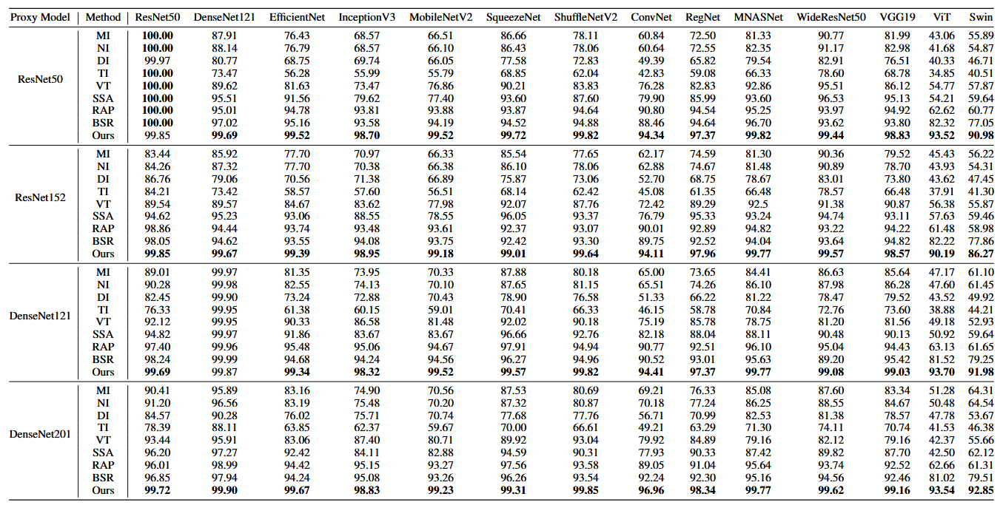
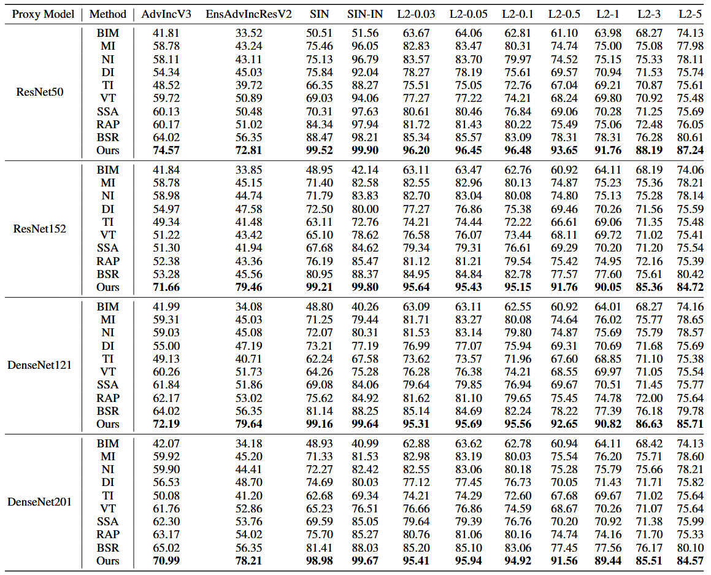
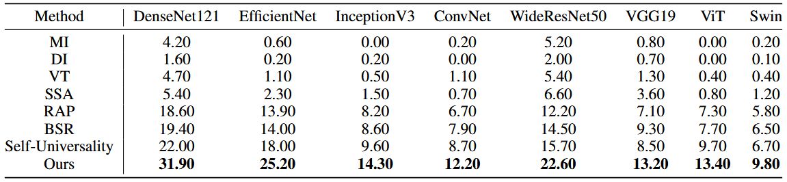
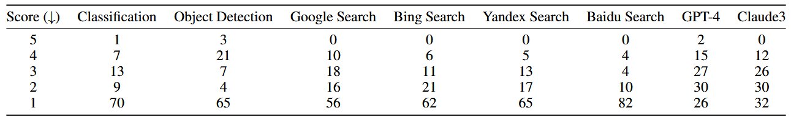
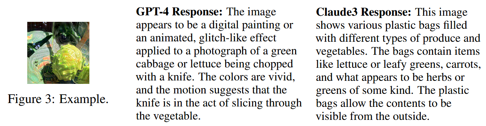
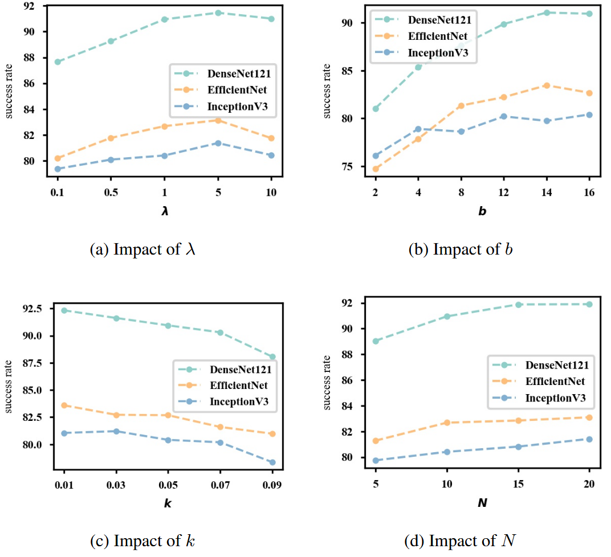

# Transferability Bound Theory: Exploring Relationship between Adversarial Transferability and Flatness

## 核心信息

- 标题: Transferability Bound Theory: Exploring Relationship between Adversarial Transferability and Flatness
- 标题翻译: 可迁移性界理论：探索对抗可迁移性与平坦性之间的关系
- 作者: Mingyuan Fan, Xiaodan Li, Cen Chen (通讯), Wenmeng Zhou, Yaliang Li
- 机构: 华东师范大学数据科学与工程学院；浙江大学区块链与数据安全全国重点实验室；阿里巴巴集团
- 发表时间: 2024年 (NeurIPS 2024)
- 发表渠道: 38th Conference on Neural Information Processing Systems (NeurIPS 2024)
- 论文链接: https://arxiv.org/abs/2311.06423
- 代码 / 项目: https://github.com/fmy266/TPA
- 数据 / 资源: ImageNet (10000张随机选取), Google Cloud Vision, GPT-4, Claude3
- 论文类型: 理论+方法的对抗攻击论文（首次为平坦性-可迁移性建立理论界）

## 原文摘要翻译

攻击和防御社区中普遍存在一种信念：对抗样本的平坦性越高，其跨模型可迁移性越好。这导致了对 sharpness-aware minimization 及其变体的研究兴趣日益增长。然而，对抗样本的可迁移性与平坦性之间的理论关系尚未被妥善建立，使得这一信念值得质疑。为弥合这一差距，我们开展了理论探索，并首次在少量实际假设下推导了对抗样本可迁移性的理论界。我们的分析挑战了这一信念：证明对抗样本平坦性的增加并不一定保证可迁移性的提升。在此基础上，我们提出了 TPA（Theoretically Provable Attack），***一种优化推导出的界的替代指标来生成对抗样本的方法***。在广泛使用的基准数据集和多种真实世界应用上的大量实验表明，TPA 能够生成比现有最先进基线更具可迁移性的对抗样本。我们希望这些结果能够纠正社区内的先入为主的印象，并促进更强的对抗攻击和防御机制的发展。源代码可在 https://github.com/fmy266/TPA 获取。

启发：
Recently, Foret et al. [14] observed a strong correlation between the flatness of the model’s loss landscape and its generalization capability,thus advocating for the optimization of the worst-case loss within a small perturbation radius to regulate the loss landscape.
[14] Pierre Foret, Ariel Kleiner, Hossein Mobahi, and Behnam Neyshabur. Sharpness-aware  minimization for efficiently improving generalization. ArXiv, abs/2010.01412, 2020. URL https://api.semanticscholar.org/CorpusID:222134093.
怀疑：
Recent works [1, 3, 39] have brought to light a thoughtprovoking finding, i.e., flat extreme points do not always lead to better generalization ability, making the relationship between adversarial transferability and flatness even more mysterious.

## 创新点

1. **首次推导了对抗可迁移性的严格理论界（Theorem 3.1）**：在五个实践上合理的假设下，将可迁移性解耦为三个可量化组件——固有模型差异分量、一阶梯度分量和二阶梯度分量。这一定理是本文最重要的理论贡献，也是后续方法设计的理论基石。

2. **挑战了"平坦性必定提升可迁移性"的社区共识**：定理揭示了一阶梯度分量（即平坦性）仅是影响可迁移性的三个因素之一。一个平坦但二阶梯度分量高的对抗样本，其迁移性可能不如一个稍尖锐但二阶梯度低的样本。这一发现纠正了 RAP、PGN、FEM 等方法背后的核心前提。

3. **提出了原理性攻击方法 TPA**：基于定理洞察，TPA 优化一个同时约束一阶和二阶梯度分量的替代指标（surrogate），而非像 PGN/GNP 那样仅惩罚一阶梯度范数。通过巧妙的泰勒展开近似（Equation 10），TPA 将原本需要 Hessian 矩阵计算的二阶信息转化为仅需一阶梯度的线性运算，同时保持理论正确性。

4. **首次将迁移攻击扩展到真实世界系统评估**：不仅包括 Google Cloud Vision（分类+检测），还攻击了四大搜索引擎（Google/Bing/Yandex/Baidu）和两大 MLLM（GPT-4 和 Claude3），弥合了学术基准与工业部署之间的评测鸿沟。

## 一句话总结

本文首次为"平坦性-可迁移性"这一经验假设提供了严格的数学分析，***证明了平坦性并非可迁移性的充分条件——二阶梯度分量同样是决定因素***；在此基础上提出的 TPA 方法通过同时约束一阶和二阶梯度，在常规和真实世界场景中均大幅超越所有基线。

---

## 作者的出发点与思路历程

### 研究动机

作者观察到，2022-2023 年间涌现了一大批基于平坦性优化的迁移攻击方法（RAP [2022]、PGN [2023]、FEM [2023]、GNP [2023]、APP [2023]），这些方法的共同前提假设是：**使对抗样本落在平坦的局部极值点能够增强其跨模型可迁移性**。这一假设直接借鉴自模型泛化理论中的 SAM [Foret et al., 2020]，即"更平坦的极小值→更好的泛化"。

然而，作者敏锐地注意到一个关键问题：**即便在模型泛化领域，平坦性与泛化能力之间的关系也远未解决**。Dinh et al. [2017] 证明了存在尖锐却泛化良好的网络；Andriushchenko et al. [2023] 实证发现平坦性在大网络中的相关性并不强。如果平坦性在泛化领域都站不住脚，那么直接将其迁移到"可迁移性"领域会更加可疑。

因此，作者提出核心研究问题 Q1：**平坦的对抗样本是否必然具有更好的可迁移性？**

### 思路展开

作者采取了"先解耦，再定界"的策略：

1. **解耦可迁移性**：将目标模型损失分解为 $L(F'(x+\delta), y) = L(F(x+\delta), y) + D(x+\delta, y)$，其中第一项是"局部有效性项"（代理模型上的攻击效果），第二项 $D(x+\delta, y) = L(F'(x+\delta), y) - L(F(x+\delta), y)$ 是"迁移相关损失项"（从代理模型到目标模型的损失变化）。直观地，高可迁移性要求局部有效性项大且迁移损失项小。

2. **定界迁移损失项**：通过对 $D(x+\delta, y)$ 做泰勒展开，结合五个实践假设，推导出 $\mathbb{E}_{p(x)}[\|D(x+\delta, y)\|_2^2]$ 的上界，该上界由三个分量组成：固有模型差异分量、一阶梯度分量（平坦性）、二阶梯度分量。

3. **揭示平坦性的不足**：定理表明，一阶梯度分量（即平坦性）虽然是一个贡献因素，但它单独无法决定上界的值。即使 $\|\nabla \log F(x+\delta)\|_2^2$ 很小（即对抗样本很平坦），只要 $\sum_i |\nabla^2 \log F(x+\delta)[i,i]|$ 很大，上界仍然可能很大，即可迁移性仍然可能很差。

4. **设计 TPA**：基于定理指导，TPA 优化一个同时约束一阶和二阶梯度分量的替代指标——通过惩罚对抗样本邻域内的梯度范数，既直接最小化一阶梯度，又隐式抑制二阶梯度（因为二阶梯度量化了一阶梯度的变化率）。这一定性上优于 PGN 等仅惩罚一阶梯度的做法。

---

## 理论推导全过程（Theorem 3.1）

### 假设与符号

**Assumption 3.1**：$x$ 的底层分布 $p(x)$ 连续且有界：$\exists B_1$ 使得 $\forall x, p(x) \leq B_1$。

**Assumption 3.2**：$p(x)$ 的梯度范数有界：$\exists B_2$ 使得 $\forall x, \|\nabla p(x)\| \leq B_2$。

**Assumption 3.3**：对抗样本在自然中出现的概率小于自然样本：$p(x+\delta) \leq p(x)$。

**Assumption 3.4**：代理模型生成的对抗样本在代理模型上的损失大于在目标模型上的损失：$L(F'(x+\delta), y) \leq L(F(x+\delta), y)$。

**Assumption 3.5**：代理模型基于 ResNet 类架构，每层为线性变换后接 ReLU 激活。

这些假设的合理性：
- Assumption 3.1-3.2 自然成立——自然样本不会以无限概率出现，否则梯度也会无界。
- Assumption 3.3 成立因为对抗样本是人为构造的，在自然界不常见。
- Assumption 3.4 使迁移攻击的讨论有意义——如果目标模型上损失更大，那攻击本身就"免费"成功了。
- Assumption 3.5 可由攻击者自由选择。

### 推导 Step 1：解耦可迁移性

将对目标模型的攻击效果分解为：

$$L(F'(x+\delta), y) = L(F(x+\delta), y) + D(x+\delta, y)$$

其中关键量是迁移相关损失项：
$$D(x+\delta, y) = L(F'(x+\delta), y) - L(F(x+\delta), y)$$

通过泰勒展开（对 $\delta$ 微小的情况）：
$$D(x, y) - D(x+\delta, y) = -\nabla L(F'(x+\delta), y)^\top \delta + \nabla L(F(x+\delta), y)^\top \delta$$

### 推导 Step 2：展开梯度内积

使用交叉熵损失，记 $F(x)[y]$ 为模型将 $x$ 分类为 $y$ 的预测概率。交叉熵的梯度满足 $\nabla L(F(x), y) = -\nabla \log F(x)[y]$。因此：

$$\nabla L(F'(x+\delta), y)^\top \delta - \nabla L(F(x+\delta), y)^\top \delta = (\nabla \log F'(x+\delta)[y] - \nabla \log F(x+\delta)[y])^\top \delta$$

在分布 $p(x)$ 下考虑 $\ell_2$ 范数平方的期望：

$$\int p(x)\|(\nabla \log F'(x+\delta)[y] - \nabla \log F(x+\delta)[y])^\top \delta\|_2^2 dx$$

利用 Cauchy-Schwarz 不等式 $\|a b\| \leq \|a\|\|b\|$：

$$\leq \int p(x)\|\delta\|_2^2 \|\nabla \log F'(x+\delta)[y] - \nabla \log F(x+\delta)[y]\|_2^2 dx$$

展开平方差：

$$= \int p(x)\|\delta\|_2^2 (\|\nabla \log F'(x+\delta)[y]\|_2^2 + \|\nabla \log F(x+\delta)[y]\|_2^2) dx - 2\int p(x)\|\delta\|_2^2 \nabla \log F'(x+\delta)[y]^\top \nabla \log F(x+\delta)[y] dx$$

### 推导 Step 3：处理第二积分（引入 Hessian）

对于第二积分，利用 $\nabla \log F'(x+\delta)[y] = \frac{\nabla F'(x+\delta)[y]}{F'(x+\delta)[y]}$ 和 $F'(x+\delta)[y] \leq 1$：

$$\int p(x)\|\delta\|_2^2 \nabla \log F'(x+\delta)[y]^\top \nabla \log F(x+\delta)[y] dx \geq \int p(x)\|\delta\|_2^2 \nabla F'(x+\delta)[y]^\top \nabla \log F(x+\delta)[y] dx$$

将内积展开为逐元素求和并应用分部积分（integration by parts）：

$$= \sum_i \left[ p(x)\|\delta\|_2^2 F'(x+\delta)[y] \cdot \nabla \log F(x+\delta)[y][i] \Big|_{-\infty}^{+\infty} - \int p(x)\|\delta\|_2^2 F'(x+\delta)[y] \nabla^2 \log F(x+\delta)[y][i,i] dx \right]$$

由于 $p(\pm\infty) = 0$，边界项消失。再利用 $F'(x+\delta)[y] \leq F(x+\delta)[y]$（Assumption 3.4）和 $\nabla^2 \log F(x+\delta)[y][i,i] \leq 0$（$\log(\cdot)$ 的二阶导为负，且 ReLU 网络的 $F(\cdot)$ 二阶导为零——Assumption 3.5）：

$$\geq -\sum_i \int p(x)\|\delta\|_2^2 F(x+\delta)[y] \cdot |\nabla^2 \log F(x+\delta)[y][i,i]| dx$$

最后利用 $F(x+\delta)[y] \leq 1$：

$$\geq -\sum_i \int p(x)\|\delta\|_2^2 |\nabla^2 \log F(x+\delta)[y][i,i]| dx$$

### 推导 Step 4：处理 $\|\nabla \log F'(x+\delta)[y]\|_2^2$ 的积分

利用等式（通过变量替换 $x \to x+\delta$ 和对齐）：
$$\int p(x+\delta)(\|\nabla \log F'(x+\delta)[y]\|_2^2 - \|\nabla \log F(x+\delta)[y]\|_2^2) dx = \int p(x)(\|\nabla \log F'(x)[y]\|_2^2 - \|\nabla \log F(x)[y]\|_2^2) dx$$

进一步，利用 $p(x+\delta) \leq p(x)$（Assumption 3.3）和常数 $C = \frac{B_1}{B_1 + B_2\|\delta\|_2}$（由 $p(x+\delta) = p(x) + \nabla p(x)^\top \delta$ 和 $\|\nabla p(x)\| \leq B_2$ 推导），得到：

$$\int p(x)\|\nabla \log F'(x+\delta)[y]\|_2^2 dx \leq C \int p(x)\|\nabla \log F(x+\delta)[y]\|_2^2 dx + C \int p(x)\|\nabla(\log F'(x)[y] - \log F(x)[y])\|_2^2 dx$$

### 推导 Step 5：合成为最终上界

将 Step 3 和 Step 4 的结果代入 Step 2，最终得到 **Theorem 3.1**：

$$\mathbb{E}_{p(x)}\{\|D(x+\delta, y)\|_2^2\} \leq \underbrace{\mathbb{E}_{p(x)}\{\|D(x, y)\|_2^2 + C \|\delta\|_2^2 \|\nabla D(x, y)\|_2^2\}}_{\text{固有模型差异分量}}$$
$$+ \underbrace{(1+C)\mathbb{E}_{p(x)}\{\|\delta\|_2^2 \|\nabla \log F(x+\delta)\|_2^2\}}_{\text{一阶梯度分量（平坦性）}} + \underbrace{2\mathbb{E}_{p(x)}\{\|\delta\|_2^2 \sum_i |\nabla^2 \log F(x+\delta)[i,i]|\}}_{\text{二阶梯度分量}}$$

其中 $C = \frac{B_1}{B_1 + B_2\|\delta\|_2} \leq 1$。

进一步，记右边三项之和为 $K$，则：
$$\|L(F'(x+\delta), y)\|_2^2 \geq |\|L(F(x+\delta), y)\|_2^2 - K|$$

### 三个分量的含义

**固有模型差异分量**：衡量代理模型与目标模型在干净样本 $x$ 上的输出差异及其梯度差异。该分量小意味着两个模型对 $x$ 的预测相近，可迁移性好。这为代理模型选择提供了新准则——***不需要架构和数据相似，只需要预测对齐***。
这个值一般很小：1.目标模型在干净样本上本来就表现良好 2.代理模型经过微调后损失也可以很小 3.，模型对正常样本的判断差不多，它们用来更新参数的梯度方向也就差不到哪去--> 以前觉得必须找“双胞胎”当替身，现在理论证明，只要替身和目标的“**答题思路（最终答案倾向）**”一致就行，不需要它们俩的“**大脑构造（网络结构）**”和“**学习经历（训练集）**”完全一样。这大大降低了攻击者挑选代理模型的难度。

**一阶梯度分量**：$\|\nabla \log F(x+\delta)\|_2^2$ 正是"平坦性"的数学表达——平坦区域梯度范数小。然而它只是三个分量之一，单独不足以决定可迁移性。

**二阶梯度分量**：$\sum_i |\nabla^2 \log F(x+\delta)[i,i]|$ 量化了损失景观的曲率。即使一阶梯度分量很小（很平坦），如果曲率很大（Hessian 对角元素绝对值大），对抗样本对微小位移仍然高度敏感，跨模型的细微差异就会被放大。

### 关键反例：$y = \sin(x^2)$

![[Papers/Adversarial-Attacks/2024_TPA/images/Fig_1.png]]
*Fig. 1: $y = \sin(x^2)$ 的一阶梯度 $y_1$、二阶梯度 $y_2$ 及其和 $y_3$。黑星标记 $y_1$ 和 $y_3$ 的最小值位置。仅最小化一阶梯度（平坦性）并不能找到使 $y_3$（总界）最优的解——平坦但二阶梯度大的点可能比稍尖锐但二阶梯度小的点更差。*

作者用 $f(x) = \sin(x^2)$ 说明问题：其一阶梯度范数 $y_1 = |2x\cos(x^2)|$ 在 $x=0$ 处为零（最平坦），但二阶梯度 $y_2 = |2\cos(x^2) - 4x^2\sin(x^2)|$ 在 $x=0$ 处为 2（很大）。此时 $y_3 = y_1 + y_2$ 并非最小。实际的最优点在 $x \approx \pm 0.9$，此处 $y_1$ 虽非零但 $y_2$ 较小，$y_3$ 达到全局最小。这直观地说明：**单纯追求平坦性不仅不够，甚至可能导致次优解**。

这个图可能不对

---

## 方法主线

### TPA 的优化目标

基于 Theorem 3.1，最优策略是联合优化局部有效性项和迁移损失项的上界。然而，上界中的二阶梯度分量需要 Hessian 矩阵，在高维空间中计算代价过高。TPA 因此采用了一个**理论上等价的替代指标**：

$$\delta^* = \arg\min_\delta \left[-L(F(x+\delta), y) + \lambda \cdot \mathbb{E}_{\Delta \sim U(-b,b)}\{\|\nabla L(F(x+\delta+\Delta), y)\|_2\}\right]$$
$$\text{s.t. } \|\delta\|_\infty \leq \epsilon, b \geq 0$$

Equation 5 第一项 $-L(F(x+\delta), y)$ 是局部有效性项，第二项是**替代上界**。

### 为什么替代指标有效？

替代指标的直观原理：惩罚 $x+\delta$ 周围样本的梯度范数 → 推动局部梯度范数趋于零 → 隐式抑制二阶梯度。

精确的数学证明（Equation 6）：

$$\sum_i |\nabla^2 \log F(x+\delta)[i,i]| = \sum_i \left| \lim_{\mu \to 0} \frac{\nabla \log F(x+\delta+\mu)[i] - \nabla \log F(x+\delta)[i]}{\mu} \right|$$
$$= \left\| \lim_{\mu \to 0} \frac{\nabla L(F(x+\delta+\mu), y) - \nabla L(F(x+\delta), y)}{\mu} \right\|_1$$

如果 $x+\delta$ 周围样本的梯度范数趋于零，则 $\nabla L(F(x+\delta+\mu), y) \approx 0$ 且 $\nabla L(F(x+\delta), y) \approx 0$，从而二阶梯度分量也趋于零。这一推导建立了"邻域梯度惩罚"与"二阶曲率抑制"之间的等价性。

### 与 PGN/GNP 的本质区别

PGN [Ge et al., 2023] 和 GNP [Wu et al., 2023] 的优化目标都只惩罚 $\|\nabla L(F(x+\delta), y)\|_2$（即 $x+\delta$ 本身的一阶梯度），而 TPA 惩罚的是 $\mathbb{E}_{\Delta}\{\|\nabla L(F(x+\delta+\Delta), y)\|_2\}$（即 $x+\delta$ 邻域内的期望梯度范数）。根据上述推导，前者仅能约束一阶梯度分量，而后者能同时约束一阶和二阶梯度分量。

### Hessian 的近化解法

Equation 5 的梯度包含 Hessian 矩阵项（Equation 7），直接计算在高维空间不可行。TPA 的解决方案：

1. 对 $L(F(x+\delta+\Delta_i+\phi), y)$ 做一阶泰勒展开（$\phi$ 很小）：
   $$L(F(x+\delta+\Delta_i+\phi), y) = L(F(x+\delta+\Delta_i), y) + \nabla L(F(x+\delta+\Delta_i), y) \phi$$

2. 两边对 $x$ 微分：
   $$\nabla L(F(x+\delta+\Delta_i+\phi), y) = \nabla L(F(x+\delta+\Delta_i), y) + H_{x+\delta+\Delta_i} \phi$$

3. 令 $\phi = k \cdot \frac{\nabla L(F(x+\delta+\Delta_i), y)}{\|\nabla L(F(x+\delta+\Delta_i), y)\|_2}$（沿梯度方向的小步长），代入上式：
   $$H_{x+\delta+\Delta_i} \frac{\nabla L}{\|\nabla L\|_2} \approx \frac{\nabla L(x+\delta+\Delta_i + k\frac{\nabla L}{\|\nabla L\|_2}) - \nabla L(x+\delta+\Delta_i)}{k}$$

这一近似将需要二次存储和三次计算时间的 Hessian 计算转化为仅需一次额外前向传播的线性操作，近似误差为 $O(k)$。

---

## 实验

### 实验设置

| 配置项 | 详情 |
|--------|------|
| 数据集 | ImageNet (10000张随机选取) |
| 代理模型 | ResNet50, ResNet152, DenseNet121, DenseNet201 |
| 目标模型 (正常) | 14个模型：ResNet50, DenseNet121, EfficientNet, InceptionV3, MobileNetV2, VGG19, WideResNet50, MNASNet, RegNet, ShuffleNetV2, SqueezeNet, ConvNet, ViT, Swin |
| 防御模型 | AdvIncV3, EnsAdvIncResV2, SIN, SIN-IN, L2约束训练(7种强度) |
| 真实世界 | Google Cloud Vision (分类+检测), Google/Bing/Yandex/Baidu 搜索, GPT-4, Claude3 |
| 扰动预算 | $\epsilon = 16/255$, 迭代 $T = 20$, 步长 $\alpha = 1.6/255$ |
| TPA 超参数 | $\lambda = 5$, $b = 16$, $k = 0.05$, $N = 10$ |

### 正常模型评估 (Table 1)

*Table 1: 不同攻击方法在 14 个正常训练模型上的攻击成功率。TPA 在所有代理-目标组合上一致超越所有基线。*

以 ResNet50 为代理模型时，TPA 在 13 个目标模型上的平均 ASR 约为 98%，比 SOTA SSA 高出约 3-5 个百分点。尤其在 ViT（93.52%）和 Swin（90.98%）等 Transformer 架构上，TPA 比最强基线 BSR（82.32%/77.05%）分别高出 11.2% 和 13.9%——TPA 是**首个在 Transformer 架构上达到平均 90% ASR 的迁移攻击方法**。

### 防御模型评估 (Table 2)

在对抗训练、风格化训练、L2 鲁棒训练等 11 种防御设置下，TPA 一致超越所有基线。特别地，在 ResNet50→EnsAdvIncResV2（集成对抗训练）这一最具挑战性的组合中，TPA 达到 72.81%，而最强基线 BSR 仅 56.35%，提升 16.5 个百分点。这验证了 TPA 的优化策略（同时约束一阶和二阶梯度）在模型差异极大的场景中尤为有效。

### 目标攻击 (Table 3)

目标攻击难度远高于非目标攻击。TPA 在所有 8 个目标模型上大幅领先，平均超出专门设计的目标攻击方法 Self-Universality 约 8-10 个百分点。

### 真实世界评估 (Table 4)

**Google Cloud Vision**：分类任务中 70% 的样本获得 1 分（完全错误），检测任务中 65% 的样本获得 1 分。TPA 成功欺骗了商业级 AI 服务。

*Fig. 2: 变扰动预算下 TPA 与 VR、SSA 的攻击成功率。TPA 在所有预算下保持支配地位。*

**搜索引擎**：Baidu 最为脆弱（82% 样本获得 1 分），Google 和 Bing 也有 56-62% 的样本被成功攻击。

*Fig. 3: GPT-4 和 Claude3 对同一张对抗样本的响应示例。两者均未能正确识别绿色果蔬（可能是卷心菜/生菜），分别产生了"数字绘画"和"塑料袋装蔬菜"的幻觉描述。*

**GPT-4 和 Claude3**：按 1-2 分算成功攻击，TPA 在 GPT-4 上达 56%，Claude3 上达 62%。这些前沿 MLLM 在视觉编码器层面存在与 CNN 代理模型共享的脆弱性。

### 消融实验

*Fig. 5: 四个超参数的消融实验。(a) $\lambda$: 太小忽略平坦性、太大忽略代理模型有效性，$\lambda=5$ 最优；(b) $b$: 增大提升平坦性估计精度，$b=16$ 最优；(c) $k$: 增大会加大近似误差，$k=0.01$ 最优；(d) $N$: 增加提升估计精度，$N=20$ 最优。*

核心发现：
- $\lambda$ 控制局部有效性和平坦性之间的权衡——太小退化为普通攻击，太大忽略代理模型上的有效性
- $k$ 越小越好（泰勒展开近似的截断误差为 $O(k)$），验证了 Hession 近似的理论推导
- $N$ 增加持续改善性能，边际收益在 $N=20$ 时衰减

---

## 讨论与局限

### 值得关注的局限性

1. **定理假设的适用范围**：Theorem 3.1 的证明严重依赖五个假设，特别是 Assumption 3.5（ReLU 网络二阶导为零）。对于使用 GELU/SiLU 的现代架构（ViT, Swin, MLLM），二阶导非零，定理中三个分量的相对权重可能需要重新评估。但作者验证了 TPA 在这些架构上仍然有效，说明优化方向本身是稳健的。

2. **小 $\delta$ 假设**：泰勒展开的精度在小扰动下才能保证。作者在附录中论证了迭代生成过程中每一步的步长确实很小，因此定理给出的是逐步上界。但对于大 $\epsilon$ 的总体效果，累积误差可能增大。

3. **无统计显著性报告**：作者坦承仅运行了一次实验（Table 7 中的 checklist 回答 "No"），未提供方差估计。这对于声称 SOTA 的方法是一个不足。

4. **未与 PGN 直接比较**：尽管 TPA 的理论直接对比了 PGN/GNP 的一阶梯度惩罚策略，实验基线中未包含 PGN（仅包含 RAP），这削弱了"TPA 优于现有平坦性方法"这一主张的可信度。

5. **代理模型-目标模型的预测对齐假设**：在真实世界评估中，商业 API 的标签空间和训练数据与 ImageNet 预训练模型差异巨大，这意味着 Assumption 3.1-3.4 可能被显著违反。TPA 在这些场景中仍然有效的机理值得深入分析。

### 未来方向

- 扩展到多步累计效应，建立全局的（而非逐步的）可迁移性理论
- 为非 ReLU 架构（Transformer, MLLM）定制理论分析
- 探索 TPA 在扩散模型、自监督模型等新兴架构上的表现

---

## 参考与引用价值

### 可复用的技术要素

- **可迁移性三分解框架**：将可迁移性解耦为"局部有效性 + 模型差异 + 一阶梯度 + 二阶梯度"，可作为分析和设计所有迁移攻击方法的通用理论工具
- **Hessian 近似的梯度差分技巧**（Equation 10）：$Hv \approx \frac{\nabla L(x+kv) - \nabla L(x)}{k}$ 是一种通用的 Hessian-vector 积近似方法，可应用于任何需要二阶优化但预算有限的场景
- **TPA 的替代指标设计原则**：通过优化邻域期望梯度（而非点梯度）来隐式约束二阶曲率，这一思想可推广到其他"平坦性"相关任务

### 关键后续问题

1. Theorem 3.1 揭示了二阶梯度分量的重要性，但现有攻击方法（包括 TPA）只隐式地约束它。能否设计一个显式优化 Hessian 对角元素的攻击方法来进一步验证理论的完备性？
2. TPA 的替代指标（邻域期望梯度范数）与原始上界（三个分量之和）之间的近似误差能否被定量界？
3. 既然"平坦性不等于可迁移性"，那么反向命题是否成立？——即高可迁移性的对抗样本是否必然具有某些特定的几何特征（如低二阶梯度）？
4. TPA 在 GPT-4/Claude3 上的成功暗示了 MLLM 的视觉编码器存在与小型 CNN 共享的对抗脆弱性。这一现象的神经科学解释是什么？为什么多模态融合和语言推理未能消除这种脆弱性？

---

*笔记生成日期: 2026-06-22*
