# Boosting Adversarial Transferability with Low-Cost Optimization via Maximin Expected Flatness

## 核心信息

- 标题: Boosting Adversarial Transferability with Low-Cost Optimization via Maximin Expected Flatness
- 标题翻译: 通过极大极小期望平坦性实现低成本优化的对抗可迁移性提升
- 作者: Chunlin Qiu, Ang Li, Yiheng Duan, Shenyi Zhang, Yuanjie Zhang, Lingchen Zhao, Qian Wang (IEEE Fellow)
- 机构: 武汉大学网络空间安全学院，空天信息安全与可信计算教育部重点实验室
- 发表时间: 2026年 (IEEE TIFS), arXiv: 2405.16181v3 (2026年1月14日)
- 发表渠道: IEEE Transactions on Information Forensics and Security (TIFS)
- arXiv: 2405.16181
- 论文链接: https://arxiv.org/abs/2405.16181
- 代码 / 项目: https://github.com/SignedQiu/MEFAttack
- 数据 / 资源: ImageNet-compatible dataset (NIPS 2017); TransferAttack benchmark
- 论文类型: 对抗攻击方法 (flatness-based transfer attack, optimization-driven)

## 原文摘要翻译

基于迁移的攻击在白盒代理模型上生成对抗样本并直接部署到黑盒目标模型上，提供了实用的无查询威胁场景。尽管最近出现了通过增强损失表面平坦性来提升可迁移性的平坦性增强方法，但这些方法存在平坦性定义分裂、启发式攻击设计导致优化局限性未被审视以及理论基础缺失等问题，从而制约了其效果和效率。本工作揭示了平坦性优化中严重不平衡的探索-利用动力学，首次建立了平坦性基础可迁移性的理论基础，并提出了一个有原则的框架来克服这些优化陷阱。具体而言，我们系统性地统一了现有方法中碎片化的平坦性定义，揭示了它们在过度探索敏感度峰值或过度利用局部平台方面的不平衡优化局限性。为解决这些问题，我们严格形式化了平均情况平坦性和可迁移性间隙，证明了***增强零阶平均情况平坦性可以最小化跨模型差异***。基于这一理论，我们设计了极大极小期望平坦性（Maximin Expected Flatness, MEF）攻击，在增强零阶平均情况平坦性的同时平衡平坦性探索与利用。在 33 个模型和 43 种当前基于迁移的攻击上的广泛评估证明了 MEF 的优势：以一半的计算成本在攻击成功率上超过 SOTA PGN 攻击 4%，在相同预算下实现 8% 的更高成功率。当与输入增强结合时，MEF 在防御装备模型上额外获得 15% 的增益，建立了新的鲁棒性基准。代码可在 https://github.com/SignedQiu/MEFAttack 获取。

## 创新点

1. **首次建立平坦性-可迁移性的理论基础**：通过定义对抗可迁移性间隙（Adversarial Transferability Gap, ATG），并利用多阶泰勒展开***证明了 ATG 的上界由代理模型的 $n$ 阶平均情况平坦性 $\bar{R}_\xi^{(n)}(x; F)$、目标模型平坦性以及跨模型梯度差异 $C_n(x)$ 共同决定***（Theorem 1）。这一定理从理论上解释了为何增强平坦性能提升可迁移性，并揭示了零阶平坦性（$n=0$）在 ReLU 网络中的主导地位——高阶项因 $\frac{\|\delta\|^n}{n!}$ 系数呈指数衰减。

2. **暴露并系统分析了平坦性优化中的探索-利用困境**：统一了六种现有平坦性增强方法（RAP, GNP, PGN, FEM, APP, TPA）的碎片化定义，将其归类为零阶/一阶、最坏情况/平均情况的四象限分类体系。通过实验（Fig. 2）首次实证揭示了最坏情况平坦性优化（RAP, PGN）导致过探索（梯度相似性低至 0.10-0.25），而平均情况方法（FEM, TPA）导致过利用（梯度相似性 0.38-0.88）——这两种缺陷严重制约了可迁移性的上限。

3. **提出极大极小期望平坦性（MEF）框架**：设计了三层协同机制——零阶最坏邻域平均平坦性度量 $\hat{R}_{\gamma,\xi}^{(0)}$（外层探索最坏区域 $B_\gamma$ + 内层平均平滑 $B_\xi$）、邻域条件采样（NCS，利用梯度引导高效定位最坏邻域）和梯度平衡优化（GBO，复用外最大化梯度替代内最小化，将计算成本减半），以有原则的方式解决探索-利用困境。

4. **极大规模的实验验证**：在 33 个模型（含 CNN、ViT、MLP、VLM、商业 API）和 43 种攻击方法上进行了全面评估。MEF 以 PGN 一半的计算量（200 BP vs. 400 BP）超越其 4.3%，全预算下超 8.5%；在 Google Cloud Vision API 上超 PGN 12.2%；首次评估了对 MLLM（LLaVA, Qwen2.5-VL 等）的跨任务迁移性。

## 一句话总结

这篇论文是平坦性增强对抗攻击领域的里程碑式工作：首次为"平坦性能提升可迁移性"这一经验假设奠定了理论基础（Theorem 1），系统揭示了现有方法中隐藏的过探索-过利用困境，并设计了 MEF 框架以一半计算成本达 SOTA，在 33 模型 × 43 攻击的超大规模评估中全面领先。

Our key insight is to leverage the complementary strengths of average-case and worst-case flatness optimization, where average-case methods stabilize local exploitation while worstcase strategies preserve global exploration capability.

---

## 问题背景与动机

### 基于迁移的黑盒攻击与平坦性增强方法的兴起

基于迁移的攻击在代理模型 $F$ 上生成对抗样本 $x^{adv} \in B_\epsilon(x)$，最大化 $J(x^{adv}, y; F)$，再部署到目标模型 $F'$。这类方法不需要访问目标模型内部信息，也不需要查询交互，因此成为最具实际威胁的攻击范式。

近年来，受到模型泛化理论中平坦极小值与泛化能力相关性的启发，平坦性增强方法（flatness-enhanced methods）兴起。这类方法的核心假设是：在更平坦的损失景观区域中生成的对抗样本具有更强的跨模型迁移能力。然而，作者指出现有方法面临两个根本性局限：

1. **平坦性定义碎片化**：RAP [7] 优化零阶最坏情况平坦性 $\hat{R}_\xi^{(0)}$，PGN [8] 优化一阶最坏情况平坦性 $\hat{R}_\xi^{(1)}$，FEM/APP [3,6] 优化零阶平均情况平坦性 $R_\xi^{(0)}$，TPA [2] 优化一阶平均情况平坦性 $R_\xi^{(1)}$，GNP [5] 优化一阶最坏情况平坦性。这些方法各自采用了不同的平坦性度量，但缺乏系统性比较，无从判断哪种平坦性度量最优。

2. **理论基础缺失**：平坦性与可迁移性之间的联系仅停留在经验假设层面，从未被严格证明。这导致优化方向可能是次优的，计算资源被浪费在对迁移性贡献有限的指标上。

### 本文解决的三个核心问题

1. **理论问题**：平坦性与可迁移性之间是否存在严格的数学关系？哪种平坦性对可迁移性贡献最大？

2. **优化问题**：不同平坦性度量之间是否存在内在矛盾？现有方法是否陷入了某种优化陷阱？

3. **效率问题**：能否在提升可迁移性的同时降低计算成本？

---

## 方法主线

### 形式化定义：$k$ 阶平坦性统一框架

作者首先将平坦性定义统一为多阶框架：

**定义 1（$\xi$-半径 $n$ 阶平坦性）** 对于任意 $\xi > 0$ 和整数 $n \in \mathbb{N}$，损失函数 $J(x)$ 在样本 $x$ 处的 $\xi$-半径 $n$ 阶最坏情况和平均情况平坦性分别定义为：

$$\hat{R}_\xi^{(n)}(x) \triangleq \max_{x' \in B_\xi(x)} \|\nabla^n J(x') - \nabla^n J(x)\|_2$$

$$R_\xi^{(n)}(x) \triangleq \mathbb{E}_{x' \sim \text{Unif}(B_\xi(x))} \left[\|\nabla^n J(x') - \nabla^n J(x)\|_2\right]$$

其中 $B_\xi(x) = \{x' \in \mathbb{R}^d : \|x' - x\|_\infty \leq \xi\}$，$\nabla^n J(x)$ 表示 $J$ 在 $x$ 处的 $n$ 阶导数，$\nabla^0 J(x) = J(x)$。

这一框架将六种现有方法分类如下表：

| 方法 | 平坦性类型 | 阶数 |
|------|----------|------|
| RAP [7] | 最坏情况 | 0阶 |
| GNP [5], PGN [8] | 最坏情况 | 1阶 |
| FEM [3], APP [6] | 平均情况 | 0阶 |
| TPA [2] | 平均情况 | 1阶 |

### 探索-利用困境的实证揭示

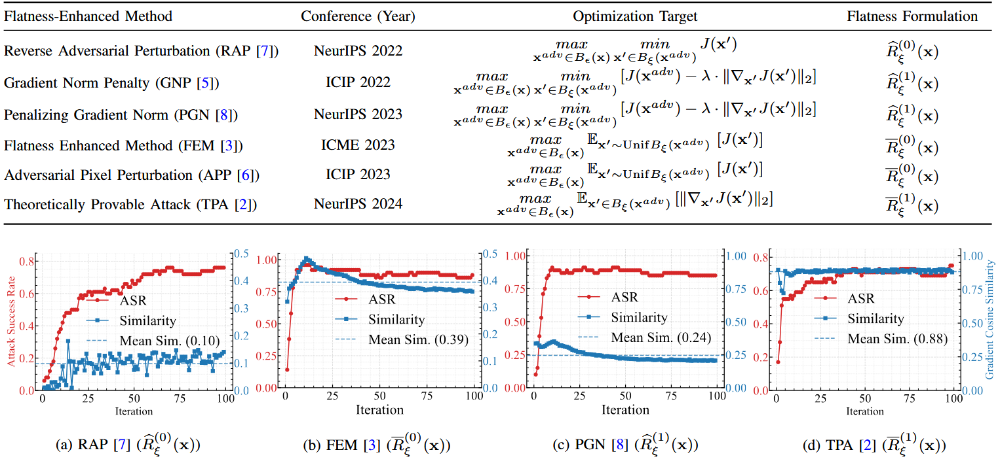
*Fig. 2: 不同平坦性度量下的优化动力学。最坏情况方法（RAP, PGN）在收敛后梯度相似性极低（0.10-0.25），反映过探索；平均情况方法（FEM, TPA）梯度相似性高（0.38-0.88），反映过利用。*

作者通过在 Res-50 上运行 100 次迭代并分析迭代间梯度余弦相似性（Fig. 2），发现了两种平坦性范式之间的系统性分歧：

- **最坏情况平坦性**（$\hat{R}_\xi^{(n)}$）的 maximization 操作使其对局部极值点高度敏感，在非凸对抗景观中持续振荡于不同敏感峰之间，表现为梯度相似性极低（RAP: 0.10, PGN: 0.25），即**过探索**（over-exploration）。

- **平均情况平坦性**（$R_\xi^{(n)}$）的 expectation 操作聚合了局部梯度变化，优先利用主导方向的梯度共识，但容易陷入由局部梯度主导的次优平台，即**过利用**（over-exploitation）。

这两种缺陷都导致了优化的过早停滞，严格限制了可达到的最大可迁移性。

### Theorem 1：平坦性-可迁移性理论基础

这是全文最核心的理论贡献。作者首先定义了对抗可迁移性间隙：

**定义 2（对抗可迁移性间隙, ATG）** 假设代理模型 $F$ 和目标模型 $F'$ 共享标签空间、使用相同损失函数、且对干净样本的性能对齐，则 ATG 定义为：

$$ATG((x, y), \delta; F, F') \triangleq J(x + \delta, y; F') - J(x + \delta, y; F)$$

**Theorem 1（基于平坦性的可迁移性上界）** 设 $F$ 和 $F'$ 为两个模型，$J$ 的 Taylor 展开最高有效阶为 $N$。定义跨模型梯度差异 $C_n(x) = \mathbb{E}_{x'} \|\nabla^n J(x', y; F') - \nabla^n J(x', y; F)\|$，则对任意 $\|\delta\| \leq \xi$，有：

$$|ATG| \leq \sum_{n=0}^{N} \frac{\|\delta\|^n}{n!} \left[\bar{R}_\xi^{(n)}(x; F) + C_n(x) + \bar{R}_\xi^{(n)}(x; F')\right] + \Delta R_N$$

推导：对于代理模型和目标模型，损失函数在x处对扰动做N阶泰勒展开：
$$J(x+\delta) = \sum_{n=0}^{N} \frac{1}{n!} \nabla_x^n J(x) \left[\delta^{\otimes n}\right] + R_N(x,\delta)$$
相减：
$$\mathrm{ATG} = \sum_{n=0}^{N} \frac{1}{n!} \left( \nabla_x^n J(F') - \nabla_x^n J(F) \right) \left[\delta^{\otimes n}\right] + \left( R_N(F') - R_N(F) \right)$$
则ATG的绝对值：
$$|\mathrm{ATG}| \le \sum_{n=0}^{N} \frac{1}{n!} \left\| T_n(x) \right\| \cdot \|\delta\|^n + \left| \Delta R_N \right|$$
其中：
$$\begin{align*} T_n(x) &= \nabla^n J(x; F') - \nabla^n J(x; F) \\ &= \left[ \nabla^n J(x; F') - \nabla^n J(x'; F') \right] \\ &\quad + \left[ \nabla^n J(x'; F') - \nabla^n J(x'; F) \right] \\ &\quad + \left[ \nabla^n J(x'; F) - \nabla^n J(x; F) \right] \end{align*}$$
两边取范数并利用 ∥a+b+c∥≤∥a∥+∥b∥+∥c∥，在领域内取期望：
$$\begin{align*} \|T_n(x)\| &\le \mathbb{E}_{x'} \left\| \nabla^n J(x; F') - \nabla^n J(x'; F') \right\| \\ &\quad + \mathbb{E}_{x'} \left\| \nabla^n J(x'; F') - \nabla^n J(x'; F) \right\| \\ &\quad + \mathbb{E}_{x'} \left\| \nabla^n J(x; F) - \nabla^n J(x'; F) \right\| \end{align*}$$
**第一项**：衡量**目标模型 F′** 在邻域内的导数波动（曲率/平坦度），记为 Rˉϵ(n)(x;F′)
**第三项**：衡量**替代模型 F** 在邻域内的导数波动，记为 Rˉϵ(n)(x;F)
**第二项**：衡量两个模型在**同一点 x′** 的导数固有差异（与邻域半径无关），记为 Cn(x)

**定理揭示的关键洞察**：
1. **可迁移性上界由三项构成**：代理模型平坦性 + 跨模型梯度差异 + 目标模型平坦性。在迁移攻击场景中只有代理模型平坦性可控。
2. **零阶平坦性主导**：高阶项因 $\frac{\|\delta\|^n}{n!}$ 系数呈指数衰减。对 ReLU 网络（$N \approx 1$），$\bar{R}_\xi^{(0)}(x; F)$ 成为主导因素。
3. **理论解释经验成功**：该定理为 RAP, PGN, FEM 等方法的经验有效性提供了严格理论解释，同时避免了 TPA [2] 仅局限于 $n=1$ 的分析局限。

基于此定理，作者确定零阶平均情况平坦性为最优优化目标——既有理论保证，又计算高效（不需要 Hessian）。

### 机制流程：MEF 攻击

MEF 的设计严格遵循 Theorem 1 的指导原则：优先优化理论上占主导的零阶平坦性，同时通过极大极小结构解决探索-利用困境。

![[2_fig3.jpg]]
*Fig. 3: MEF 攻击概览。(a) 迭代优化流程：邻域条件采样（NCS）通过内最小化将随机样本转换为最坏邻域样本，外最大化聚合这些区域的梯度更新对抗样本。(b) 几何解释：MEF 寻找平坦极大值以最小化代理模型 F 与目标模型 F' 之间的 ATG。*

**步骤 1 — 邻域条件采样（NCS）**：在 $B_\gamma(x^{adv})$ 中均匀采样 $N$ 个点，利用式 (12) 进行符号梯度更新：$x_{t+1,i} = x_{t,i} - \xi \cdot \text{sign}(\nabla_x J(x_{t,i}))$，迭代 $T$ 次后投影回 $B_\xi(x_{0,i})$ 和 $B_\gamma(x)$。NCS 利用梯度引导高效定位最坏期望损失区域，消除了额外采样开销。

**步骤 2 — 梯度计算**：在 NCS 输出的最坏邻域点 $\{x'_{t,i}\}$ 上计算梯度 $\{g_{t,i}\} = \nabla_x J(\{x'_{t,i}\}, y; F)$。

**步骤 3 — 梯度平衡优化（GBO）**：GBO 的核心创新在于**复用外最大化梯度替代内最小化**——利用连续对抗样本间的几何邻近性，用上一轮的外梯度 $g_{t-1,i}$ 近似当前内梯度。内更新公式为：
$$g_{t,i}^{inner} = \frac{\{g_{t,i}\}}{\|\{g_{t,i}\}\|_1} - \mu_{inner} \cdot \{g_{t,i}^{inner}\}$$
这一策略完全消除了内最小化的计算开销（原来需要每点多次反向传播），将总计算量减半。

**步骤 4 — 外梯度聚合与更新**：
$$g_t^{outer} = \mu_{outer} \cdot g_t^{outer} + \frac{1}{N}\sum_{i=1}^{N} \frac{\{g_{t,i}\}}{\|\{g_{t,i}\}\|_1}$$
$$x^{adv}_{t+1} = \Pi_{B_\epsilon(x)}[x^{adv}_t + \alpha \cdot \text{sign}(g_t^{outer})]$$

![[3_algorithm.jpg]]
*Algorithm 1: MEF 攻击的完整伪代码。*

![[Papers/Adversarial-Attacks/2026_MEF/images/4_fig4.jpg]]
*Fig. 4: GBO 相对 PGD 内优化的优势。GBO 在 10 次迭代内达 90-98% 迁移成功率，PGD 需 100 步仅 84-90%，实现 10× 更快收敛且提升 6-14% 绝对性能。*

### GBO 与 PGD 内优化的消融对比

针对 MEF 的极大极小结构中的优化不平衡问题（内最小化需要精细的多点梯度下降，外最大化需全局协调），作者比较了 GBO 与 PGD 内优化（1-4 步）。如 Fig. 4 所示，GBO 通过梯度复用和动量稳定化，不仅收敛更快（10 步 vs. 100 步），还实现了更高的迁移成功率，验证了 GBO 设计的有效性。

---

## 实验

### 实验设置

| 配置项 | 详情 |
|--------|------|
| 数据集 | ImageNet-compatible dataset (NIPS 2017), 1000张, 299×299 |
| 代理模型 | Res-50, Res-101, Inc-v3, Inc-v4 |
| 目标模型 (标准CNN) | Res-50, Res-101, Inc-v3, Inc-v4, IncRes-v2, VGG-19, Dense-121, Xception |
| 目标模型 (异架构) | MobileNetv2, PNASNet-L, ViT-B/16, ViT-L/32, PiT-S, MLP-Mixer, ResMLP |
| 防御模型 | 对抗训练 (Inc-v3adv/ens3/ens4, IncRes-v2ens), 纯化 (HGD, NRP), 认证防御 (RS), 扩散纯化 (DiffPure, DensePure), RobustBench (MIMIR, ARES, MeanSparse) |
| 商业API | Google Cloud Vision, Amazon Rekognition, Azure AI Vision, Baidu AI Cloud, Alibaba Cloud, Tencent Cloud |
| 多模态大模型 | LLaVA, Unidiffuser, MiniGPT-4, Qwen2.5-VL |
| 对比攻击方法 | 43种（含梯度稳定化、平坦性增强、数据驱动、模型驱动、特征层、生成式、查询式） |
| 扰动预算 | $\epsilon = 16/255$, $T = 10$ (MEFH) / $T = 20$ (MEFF) |
| MEF 超参数 | $\gamma = 2\epsilon$, $\xi = 0.15\epsilon$, $\mu_{outer}=0.5$, $\mu_{inner}=0.9$, $N=20$ |

### 正常训练模型上的标准评估
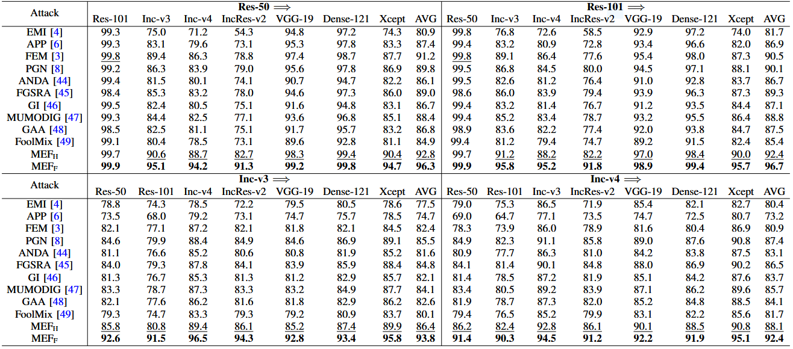
MEF 设计了两个变体：MEFH（$T=10$，PGN 一半成本）和 MEFF（$T=20$，与 PGN 同等成本）。在 4 代理 × 8 目标的评估中：

- **MEFH** 平均成功率 89.93%，已超越 SOTA PGN（88.20%），且仅需 PGN 一半计算量（200 BP vs. 400 BP）
- **MEFF** 平均成功率 94.84%，全面超越 PGN，确立了新的 SOTA

相比 FEM（在 ResNet 代理上表现强劲），PGN 的全局平均值略高（88.20% vs. 88.13%）。MEF 的设计优势在跨架构场景中更为突出。

### 跨架构泛化
在 MobileNet、PNASNet、ViT、PiT-S、MLP-Mixer、ResMLP 七种异构架构上：
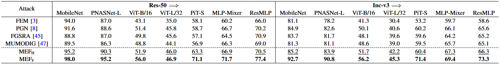

MEF 在 CNN→Transformer 这一最具挑战性的跨架构场景中仍保持领先，验证了零阶平坦性优化能够提取几何不变的特征，跨越根本不同的架构范式。

表4：集成模型；表五：输入增强
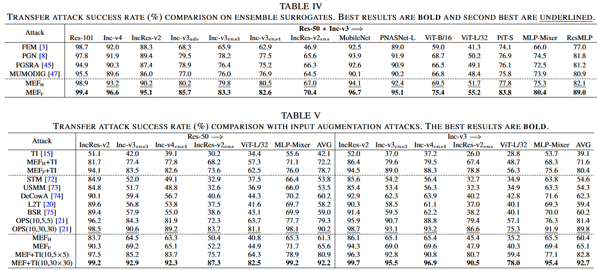

### 防御模型评估 

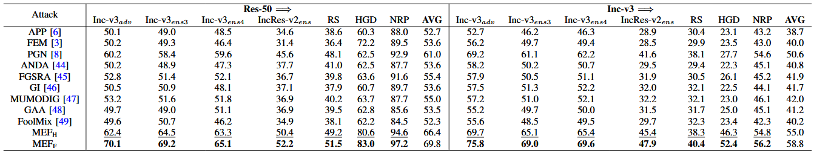
在七种标准防御模型上（Table X），MEFH 以 PGN 一半预算实现 60.70% 平均成功率（PGN: 55.84%），MEFF 进一步提升至 64.30%（+8.46%）。

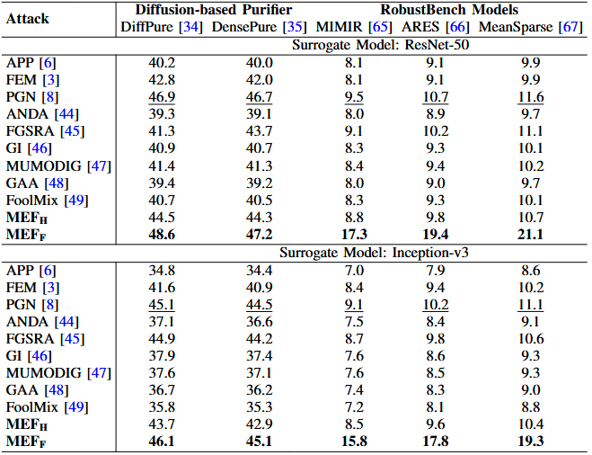
在先进防御模型上（Table XI），MEF 的优势更加显著：
- 对 **MeanSparse** (RobustBench SOTA): MEFF 达 21.1%（PGN 仅 11.6%），近乎翻倍
- 对 **DiffPure**: MEFF 达 48.6%（PGN: 46.9%）
- 对 **DensePure**: MEFF 达 47.2%（PGN: 46.7%）

这验证了 MEF 生成的对抗样本在结构上足够稳定，能够经受随机纯化和鲁棒特征对齐。

### 商业 API 与多模态大模型 

在六种商业视觉 API 上，MEF 一致超越基线。**在 Google Cloud Vision API 上，MEFF 达 79.40% T-1 成功率，超 PGN 12.2%**；在 Alibaba Cloud 上达 91.70%。

在多模态大模型评估中，MEF 首次展示了跨范式的对抗迁移性。使用 CLIP 文本编码器计算 Fooling Rate（$\tau=0.4$），MEFF 在四个 MLLM 上平均 36.5%，在 **Qwen2.5-VL 上达 41.5%，超最强基线 FEM (26.9%) 超过 14%**。

### 输入变换兼容性与跨范式对比 

MEF 可与 TI、DI、SI、Admix、SSA 等输入变换无缝集成。**MEF+TI(10,30×30) 达到 92.45% 平均成功率，超越复杂的 OPS [21] 框架（90.00%）**。高采样密度策略有效弥合了架构差异——ViT-L/32 上的成功率从 56.8% 飙升至 80.3%。

与其他攻击范式（代理精炼、特征层、生成式、查询式）对比（Table VI, VII），MEF 在零查询、低扰动的前提下超越 Square Attack 等 5000-query 方法，且视觉质量更优（SSIM 0.751 vs. 0.579）。

### 收敛性与计算效率分析

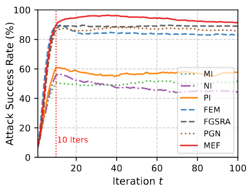
*Fig. 5: MEF 在 100 次迭代中的收敛曲线。MEF 持续积累增益直至 $T=36$（峰值 96.40%），而 PGN 等基线在 $T=10$ 后迅速平稳甚至下降。MEF 有效缓解了过拟合。
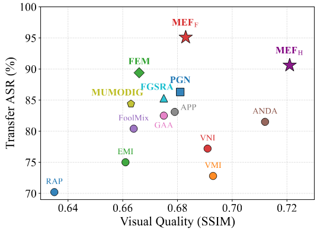
Fig. 6: 迁移性（ASR）与视觉质量（SSIM）的权衡。MEF 占据最优的右上象限，兼顾强度与隐蔽性。*

MEF 的收敛行为与基线截然不同。PGN 等方法在 $T=10$ 后迅速平稳甚至下降（过拟合代理模型），而 **MEF 持续积累增益至 $T=36$，峰值 96.40%，比 $T=10$ 时再提升 6.6%**。在计算效率上：

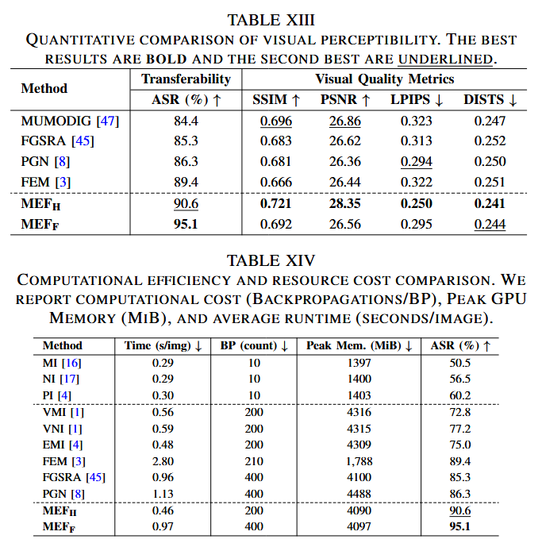

MEFH 以 PGN 一半的梯度计算量和更低显存实现 **2.4× 加速**和 **+4.3% ASR** 提升。

### 消融实验 

![][images/Fig_7.png]]
*Fig. 7: 六个关键参数的消融实验。$\gamma = 2\epsilon$ 和 $\xi = 0.15\epsilon$ 在所有目标上泛化为最优值；$\mu_{inner} = 0.9$ 贡献约 10% 的增益，对性能至关重要。*

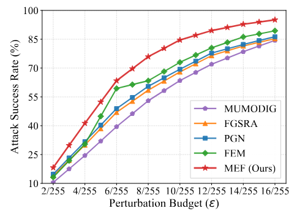
*Fig. 8: 不同扰动预算下的攻击成功率。在 $\epsilon = 4/255$ 时 MEF 仍达 41.3%，超 PGN (31.7%) 近 10%。MEF 的优势源于精确识别几何平坦方向而非依赖大扰动范数。*

关键参数发现：
- $\gamma = 2\epsilon$, $\xi = 0.15\epsilon$ 在所有目标上泛化为最优值，**无需逐模型调参**
- **$\mu_{inner} = 0.9$ 贡献了约 10% 的绝对性能提升**（内动量的稳定化至关重要）
- $N$ 增大持续改善性能，$T$ 从 10 增至 20 带来 37.2% 的大幅增益

### 损失景观平坦性定量验证 
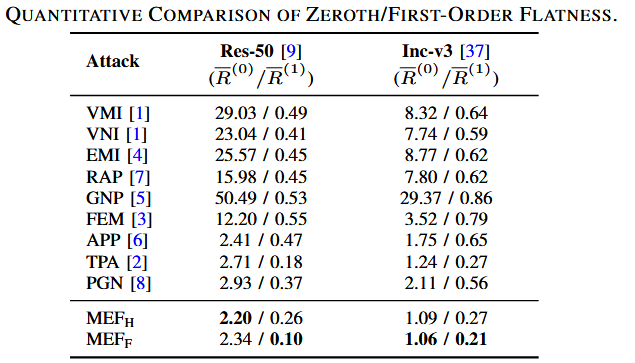
通过蒙特卡洛估计 $R_\xi^{(0)}$ 和 $R_\xi^{(1)}$（$\xi = 32/255$），MEFH 在所有方法中达到最低的 $R_\xi^{(0)}$，而 MEFF 进一步最小化了 $R_\xi^{(1)}$——验证了"优化零阶平坦性固有地抑制梯度变化"这一理论预测。

---

## 讨论与局限

### 值得关注的局限性

1. **ATG 框架的假设约束**：Theorem 1 要求代理模型和目标模型在干净样本上损失对齐（$|J(x; F') - J(x; F)| \approx 0$）。当迁移至结构差异极大的模型（如 CNN→ViT）或商业 API（未知标签空间）时，这一假设被违反，但实验表明 MEF 在此类场景中仍保持有效——作者在补充材料中讨论了 ATG 在假设违背情况下的经验泛化。

2. **CNN→Transformer 的结构性差距**：即使在 MEF 的优化下，跨范式迁移仍存在显著差距（ViT 上约 45%，CNN 上 >90%）。作者将此归因于 CNN 局部卷积与 Transformer 全局自注意力之间的根本归纳偏置差异导致的 $C_n(x)$ 过大。

3. **对 $\mu_{inner}$ 的敏感性**：消融实验显示 $\mu_{inner} = 0.9$ 贡献了约 10% 的绝对性能提升，这意味着该参数对最终性能影响极大，可能需要针对不同代理模型微调。

4. **ReLU 网络的 $N \approx 1$ 假设**：Theorem 1 中"零阶主导"的结论依赖于 ReLU 网络高阶导数消失的假设。对于使用 GELU/SiLU 等平滑激活函数的现代架构（ViT, MLLM），高阶项的影响可能需要重新审视。

5. **零查询与视觉隐蔽性的权衡**：作者坦承，基于迁移的攻击通常需要较大的扰动预算来确保对抗特征对未知目标的泛化。MEF 在 $SSIM \approx 0.69$ 下达 95.1%，虽然提供了最优权衡，但在严格隐蔽性场景下仍有局限。

### 未来方向

- 探索与模型无关的先验（agnostic priors）以调和跨域可迁移性与视觉隐蔽性之间的权衡
- 将平坦性优化框架扩展到更多模态（语音、文本、视频）
- 为 CNN→Transformer 的跨范式迁移建立更精细的理论分析

---

## 参考与引用价值

### 可复用的技术要素

- **$k$ 阶平坦性统一分类体系**：将平坦性按"最坏/平均"×"阶数"分类，可作为评估和分析所有平坦性增强方法的通用框架
- **ATE 上界作为理论工具**：Theorem 1 提供了分析可迁移性的普适数学框架，可用于指导未来攻击/防御方法的设计
- **GBO 梯度复用策略**：利用连续对抗样本间的几何邻近性，将内优化梯度替换为上一轮外梯度，是一种通用的极大极小优化加速技术
- **MEF 超参数组合**：$\gamma = 2\epsilon$, $\xi = 0.15\epsilon$, $\mu_{inner} = 0.9$, $\mu_{outer} = 0.5$, $N = 20$ 可作为复现和调优起点
- **开源代码**：https://github.com/SignedQiu/MEFAttack

### 关键后续问题

1. Theorem 1 的 ATG 上界在理论上为平坦性-可迁移性提供了"充分性"论证，但它是否也是"必要性"的？即是否所有高迁移性的对抗样本都必然具有低平坦性值？
2. 在 GELU/SiLU 等非 ReLU 激活函数下，高阶平坦性的贡献是否需要重新评估？是否需要调整 MEF 以包含 $R_\xi^{(1)}$？
3. GBO 的梯度复用策略在多大程度上依赖于 $\|\delta\| \ll 1$ 的假设？在更大扰动预算下是否仍然有效？
4. MEF 在多模态（图像→文本）和跨任务（分类→描述）迁移中的有效性意味着对抗性特征具有某种任务无关性，其几何本质是什么？
5. 能否基于 Theorem 1 中的 $C_n(x)$（跨模型梯度差异）设计防御方法，通过主动增大不同模型间的 $C_n(x)$ 来抑制迁移性？

---

*笔记生成日期: 2026-06-18*
