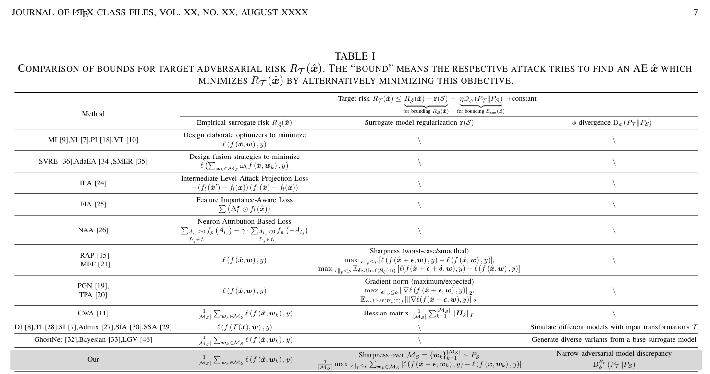
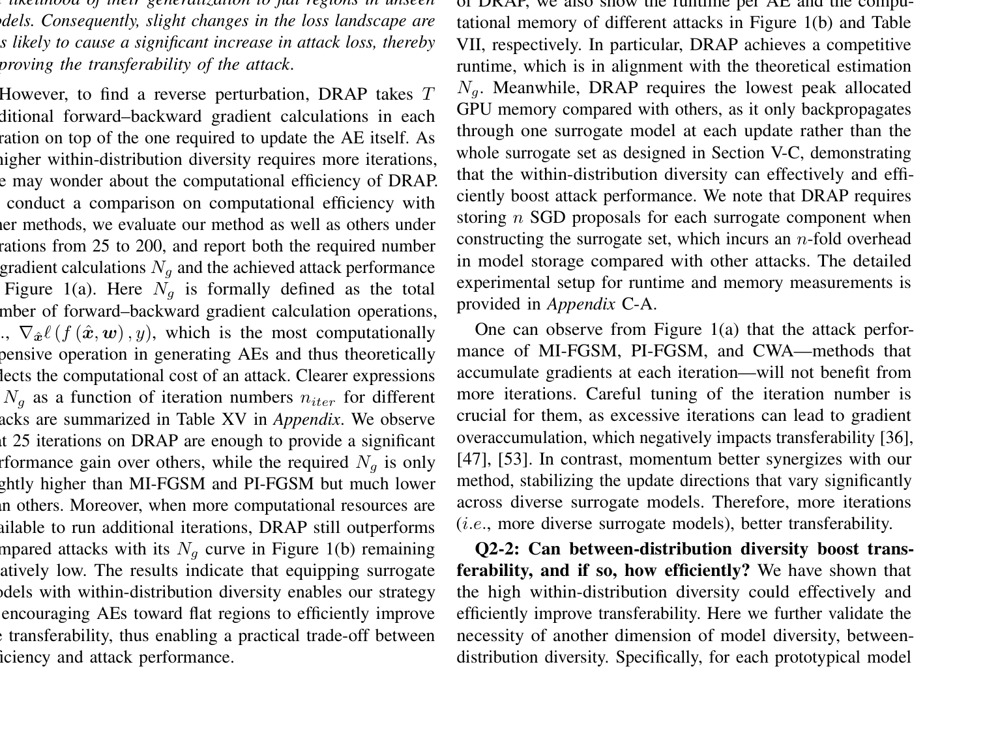
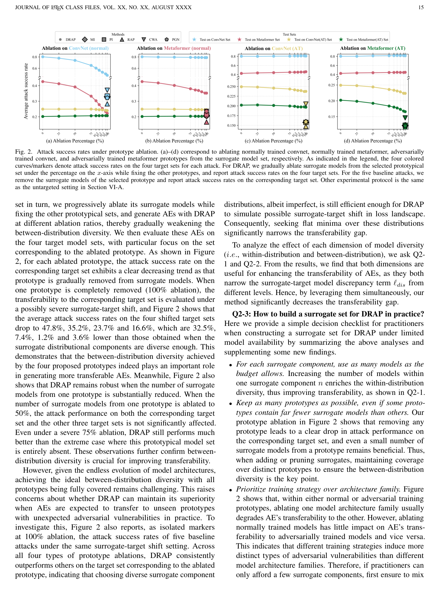

# Seeking Flat Minima over Diverse Surrogates for Improved Adversarial Transferability: A Theoretical Framework and Algorithmic Instantiation

## 核心信息

- **作者**: Meixi Zheng, Kehan Wu, Yanbo Fan, Rui Huang, Baoyuan Wu† (CUHK-Shenzhen & Nanjing University)
- **发表**: IEEE Transactions on Pattern Analysis and Machine Intelligence (TPAMI), 2026 (arXiv:2504.16474v2, 29 Mar 2026)
- **代码**: https://github.com/SCLBD/blackboxbench
- **该工作为前期会议论文 RAP (NeurIPS 2022) 的期刊扩展版**

## 原文摘要翻译

基于迁移的黑盒对抗攻击设定要求在已知代理模型上生成对抗样本，并使其对未知目标模型保持有效。尽管该任务具有重要实践价值，已有大量方法被提出，但多数方法基于启发式设计和直觉验证，缺乏理论基础。为填补这一空白，我们推导了一个新颖的迁移性上界，为对抗样本迁移性提供了可证明的保证。理论分析具有两大优势：(i) 通过构建通用攻击框架深化对已有方法的理解；(ii) 为设计有效的攻击算法提供指导。理论结果表明，在代理模型集上优化对抗样本朝向平坦极小值，同时通过对抗模型差异度控制代理-目标模型偏移，可对对抗样本迁移性提供全面的保证。这一结果进一步导出了一个通用的基于迁移的攻击框架，在此框架下我们发现已有方法仅考虑了影响迁移性的部分因素。在算法层面，受理论结果启发，我们首先精心构造代理模型集，使其中的模型对对抗样本展现出多样化的对抗脆弱性，以缩小实例化的对抗模型差异度。然后，生成模型多样性兼容的反向对抗扰动 (DRAP)，有效提升对抗样本在多样化代理模型上的平坦性，从而改善迁移性。在 NIPS2017 和 CIFAR-10 数据集上针对多种目标模型的大规模实验验证了所提攻击的有效性。

## 创新点

1. **首次给出对抗迁移性的 PAC-Bayes 可证明上界**：将目标对抗风险分解为代理对抗风险与迁移性间隙，分别用 sharpness penalty 和 adversarial model discrepancy 上界，得到了一个全面的迁移性保证 
2. **提出 adversarial model discrepancy（对抗模型差异度）**：基于 $\phi$-divergence 的变分表示，定义了仅关注"对抗显著"输入的模型分布差异度量，其针对性优于传统的 $\phi$-divergence（不会高估迁移性间隙）
3. **模型多样性两个维度（between-distribution & within-distribution diversity）**：通过 TV/KL/$\chi^2$ 三种 divergence instantiation 推导出构建代理模型分布的双重多样性原则
4. **Model-Diversity-compatible Reverse Adversarial Perturbation (DRAP)**：将 RAP 的单模型共同反向扰动升级为每个代理模型独立的特异性反向扰动，避免多模型梯度冲突
5. **将已有攻击方法统一到泛化框架中**：Table I 系统比较了优化类、特征类、输入变换类、模型类方法在 bound 中的角色，揭示它们仅控制了 bound 中的部分项

## 一句话总结

本文利用 PAC-Bayes 理论和 $\phi$-divergence 变分表示，证明了对抗样本迁移性的上界由(1)代理模型经验风险、(2)loss landscape sharpness、(3)对抗模型差异度三项决定，并据此设计 DRAP 算法，在多样化代理模型集上同时优化平坦性和多样性，在 31 个目标模型上取得平均 46.2% 的无目标攻击成功率（SIA 为 45.1%，CWA 为 34.5%）。

---

## 作者的出发点与思路历程

作者团队的前期工作 RAP (NeurIPS 2022) 是首个试图通过优化 loss landscape flatness 来提升对抗迁移性的方法，但存在两个核心缺陷：(1) flatness 与 transferability 的关系仅在 RAP 论文中用一张示意图直觉性说明，缺乏严格理论支撑；(2) RAP 使用单一的全局反向扰动在多个代理模型上优化，当代理模型间存在显著对抗脆弱性差异时，这个全局扰动的优化方向可能是各模型独立最优方向的折中，导致"weak reverse perturbation"。

作者的核心判断是：**将迁移性分解为"代理模型上的泛化误差 + 代理-目标模型分布偏移"两个可控量，并分别给出 PAC-Bayes 型上界和 $\phi$-divergence 型上界，就能得到一个有机统一的迁移性保证**。这个分解本身是 PAC-Bayes 领域适应理论的经典套路（source risk + discrepancy），但作者将其迁移到"模型分布间"而非"数据分布间"的设定中有两个微妙之处：

第一，PAC-Bayes bound 要求 i.i.d. 假设，但代理模型和目标模型显然不是同分布的（例如 ResNet-50 vs ViT），作者通过重新定义"instance=模型, concept=对抗样本"的角色反转来适配——这正是该工作的一个关键洞察。

第二，传统的 $\phi$-divergence 度量的是全空间上的分布差异，但对抗攻击只关心那些"对抗成功率高的候选 AE 所在区域"的模型差异。因此作者定义了 localized adversarial space $\hat{\mathcal{X}}_r = \{\hat{x} \mid R_S(\hat{x}) \leq r\}$，将对 $\phi$-divergence 的变分表示限制在该子集上，得到更具针对性的上界。

从 bound 到算法的转化体现了作者从理论到实践的完整思考链：
- Bound 中的 sharpness 项 → 对应 min-max bi-level optimization（内层最大化反向扰动，外层最小化对抗损失）
- Bound 中的 discrepancy 项 → 对应构建 diverse surrogate set 的两个维度（between-distribution: 四个原型；within-distribution: SGD trajectory 采样）
- 两项同时优化才构成完整的迁移性保证，这解释了为何已有方法（只优化其中一项或零项）效果次优

作者还通过 KL 和 $\chi^2$ 实例化揭示了 bound 中的 $c_1, c_2$ trade-off：KL 允许选 $c_1 > 1$ 以 $1/c_1 < 1$ 缩小 discrepancy 项的系数（但 $c_2$ 相应增大），而 $\chi^2$ 的 feasibility condition 更宽松（$c_2 \geq \frac{c_1}{4} \cdot \frac{\mathrm{Var}}{\mathbb{E}}$），这种 trade-off 为实际调参提供了理论依据。

---

## 问题背景与动机

### 问题形式化

给定代理模型分布 $\mathcal{P}_S$（攻击者可观察和利用）和目标模型分布 $\mathcal{P}_T$（不可见），在扰动预算 $\gamma$ 内生成对抗样本 $\hat{x}$ 使得：
$$\min_{\hat{x} \in \hat{\mathcal{X}}} R_T(\hat{x}) = \mathbb{E}_{w \sim \mathcal{P}_T}[\ell(f(\hat{x}, w), y)]$$

由于 $\mathcal{P}_T$ 不可见，实际只能最小化代理对抗风险 $R_S(\hat{x})$。但：
$$R_T(\hat{x}) = \underbrace{R_S(\hat{x})}_{\text{代理风险}} + \underbrace{(R_T(\hat{x}) - R_S(\hat{x}))}_{\text{迁移性间隙 } \mathcal{E}_{\text{trans}}}$$

仅优化 $R_S(\hat{x})$ 无法保证 $R_T(\hat{x})$ 降低，因为 $\mathcal{E}_{\text{trans}}$ 可能很大。

### 已有方法在统一框架下的局限

在作者导出的通用框架（Equation 25）下：
$$R_T(\hat{x}) \leq \hat{R}_S(\hat{x}) + r(\mathcal{S}) + \eta D_\phi(\mathcal{P}_T \| \mathcal{P}_S) + \text{constant}$$

- **优化类方法** (MI, NI, PI, VT): 仅优化 $\hat{R}_S(\hat{x})$，忽略 sharpness 和 discrepancy
- **RAP, PGN, CWA, MEF**: 优化 $\hat{R}_S(\hat{x}) +$ sharpness，但忽略 discrepancy
- **输入变换/模型调优类** (DI, SIA, GhostNet, Bayesian): 试图缩小 $D_\phi$，但优化器仍使用朴素的 ERM/I-FGSM

**没有方法同时控制所有三个关键因素**，且多数方法隐式假设了错误的 i.i.d. 条件。

---

## 理论推导全过程

### 预备：$\phi$-divergence 的变分表示

**定义** ($\phi$-divergence): 对概率分布 $\mu, \nu$（密度为 $p_\mu, p_\nu$），定义域 $\mathcal{W} \subset \mathbb{R}^{|w|}$：
$$D_\phi(\mu \| \nu) = \int p_\nu(w) \phi\left(\frac{p_\mu(w)}{p_\nu(w)}\right) dw$$

其中 $\phi: \mathbb{R}^+ \to \mathbb{R}$ 凸、下半连续，$\phi(1) = 0$。特殊情形：
- $\phi(x) = \frac{1}{2}|x-1|$: TV 距离
- $\phi(x) = x\log x$: KL 散度
- $\phi(x) = (x-1)^2$: $\chi^2$ 散度

**引理 1** (变分表示，[14] Theorem 1): 对任意可测函数族 $\mathcal{G}$ 和变换族 $\mathcal{T}$：
$$D_\phi(\mu \| \nu) = \sup_{g \in \mathcal{G}} \{\sup_{T \in \mathcal{T}} \{\mathbb{E}_{w \sim \mu}[T(g(w))] - \mathbb{E}_{w \sim \nu}[\phi^*(T(g(w)))]\}\}$$

取仿射变换 $T_{\alpha,t} = tg + \alpha$ 得：
$$D_\phi(\mu \| \nu) = \sup_{g \in \mathcal{G}, t \in \mathbb{R}} \mathbb{E}_{w \sim \mu}[tg(w)] - \inf_{\alpha \in \mathbb{R}}\{\mathbb{E}_{w \sim \nu}[\phi^*(tg(w) + \alpha)] - \alpha\}$$

**关键洞察**: 限制 $\mathcal{G}$ 到子集会得到 $D_\phi$ 的下界。作者正是通过将 $\mathcal{G}$ 限制为 $\hat{\mathcal{G}}_r = \{\ell(f(\hat{x}', w), y) : \hat{x}' \in \hat{\mathcal{X}}_r\}$ 来定义更紧的差异度。

---

### 第一部分：定义对抗模型差异度 (Definition 4)

**定位对抗空间**：$\hat{\mathcal{X}}_r = \{\hat{x} \in \hat{\mathcal{X}} \mid R_S(\hat{x}) \leq r\}$，即代理风险不超过 $r$ 的候选 AE 集合。

**定义对抗模型差异度** $D_\phi^{\hat{\mathcal{X}}_r}(\mathcal{P}_T \| \mathcal{P}_S)$：
$$D_\phi^{\hat{\mathcal{X}}_r}(\mathcal{P}_T \| \mathcal{P}_S) = \sup_{\hat{x}' \in \hat{\mathcal{X}}_r, t \in \mathbb{R}} \mathbb{E}_{w \sim \mathcal{P}_T}[t\ell(f(\hat{x}', w), y)] - \inf_{\alpha \in \mathbb{R}}\{\mathbb{E}_{w \sim \mathcal{P}_S}[\phi^*(t\ell(f(\hat{x}', w), y) + \alpha)] - \alpha\}$$

**性质**:
1. $D_\phi^{\hat{\mathcal{X}}_r}(\mathcal{P}_T \| \mathcal{P}_S) \leq D_\phi(\mathcal{P}_T \| \mathcal{P}_S)$（限制函数族 → 下界）
2. 对 $r$ 单调递增
3. 非负，等号成立当 $\ell(f(\hat{x}', w), y)|_{w \sim \mathcal{P}_S} \overset{d}{=} \ell(f(\hat{x}', w), y)|_{w \sim \mathcal{P}_T}$

**与 $\phi$-divergence 的关系**: 由 $\phi^*(t\ell + \alpha) \geq t\ell + \alpha$ 可知当 $t = 0$ 时取零，非负性得证。$D_\phi^{\hat{\mathcal{X}}_r}$ 是 $D_\phi$ 的下界——它只捕获"对抗显著"输入上的差异，因此更紧。

---

### 第二部分：迁移性间隙上界 (Theorem 2)

**定理陈述**: 定义 $K_S^{\hat{x}}(t) = \inf_\alpha \{\mathbb{E}_{w \sim \mathcal{P}_S}[\phi^*(t\ell(f(\hat{x}, w), y) + \alpha)] - \alpha\} - \mathbb{E}_{w \sim \mathcal{P}_S}[t\ell(f(\hat{x}, w), y)]$。对任意 $\hat{x} \in \hat{\mathcal{X}}_r$ 和满足 $K_S^{\hat{x}}(c_1) \leq c_1 c_2 \mathbb{E}_{w \sim \mathcal{P}_S}[\ell(f(\hat{x}, w), y)]$ 的常数 $c_1, c_2 \in [0, +\infty)$：

$$\mathcal{E}_{\text{trans}}(\hat{x}) \leq \frac{1}{c_1} D_\phi^{\hat{\mathcal{X}}_r}(\mathcal{P}_T \| \mathcal{P}_S) + c_2 r$$

**推导思路**（完整证明见 Appendix A）：

1. 目标：上界 $\mathcal{E}_{\text{trans}}(\hat{x}) = R_T(\hat{x}) - R_S(\hat{x})$
2. 对任意 $t \in \mathbb{R}$，由变分表示的 supremum 性质：
   $$\mathbb{E}_{w \sim \mathcal{P}_T}[t\ell(f(\hat{x}, w), y)] \leq \mathbb{E}_{w \sim \mathcal{P}_S}[\phi^*(t\ell(f(\hat{x}, w), y) + \alpha)] - \alpha + D_\phi^{\hat{\mathcal{X}}_r}(\mathcal{P}_T \| \mathcal{P}_S)$$
3. 取 $t = c_1$，利用 $\phi^*$ 的凸性展开：
   $$\mathbb{E}_{\mathcal{P}_T}[c_1\ell] \leq \inf_\alpha \{\mathbb{E}_{\mathcal{P}_S}[\phi^*(c_1\ell + \alpha)] - \alpha\} + D_\phi^{\hat{\mathcal{X}}_r}$$
4. 由 $K_S^{\hat{x}}(c_1)$ 的定义：
   $$= \mathbb{E}_{\mathcal{P}_S}[c_1\ell] + K_S^{\hat{x}}(c_1) + D_\phi^{\hat{\mathcal{X}}_r}$$
5. 两边除以 $c_1$，利用约束条件 $K_S^{\hat{x}}(c_1) \leq c_1 c_2 \mathbb{E}_{\mathcal{P}_S}[\ell] \leq c_1 c_2 r$（因 $\hat{x} \in \hat{\mathcal{X}}_r$）：
   $$R_T(\hat{x}) - R_S(\hat{x}) \leq \frac{1}{c_1} D_\phi^{\hat{\mathcal{X}}_r} + c_2 r$$

**TV 实例化** (Corollary 1): 当 $\phi(x) = \frac{1}{2}|x-1|$，$\phi^*(t) = t$ for $|t| \leq \frac{1}{2}$。取 $c_1 = 1, c_2 = 0$（feasibility 自动满足因 $K_S^{\hat{x}}(1) \leq 0$），得到简洁形式：
$$\mathcal{E}_{\text{trans}}(\hat{x}) \leq D_{\text{TV}}^{\hat{\mathcal{X}}_r}(\mathcal{P}_T \| \mathcal{P}_S) = \sup_{\hat{x}' \in \hat{\mathcal{X}}_r} |\mathbb{E}_{\mathcal{P}_T}[\ell] - \mathbb{E}_{\mathcal{P}_S}[\ell]|$$

**KL 实例化** (Corollary 2): $\phi(x) = x\log x$，$\phi^*(t) = e^{t-1}$。当 $c_1 > 0, c_2 \geq \frac{e^{c_1}-1-c_1}{c_1}$：
$$\mathcal{E}_{\text{trans}}(\hat{x}) \leq \frac{1}{c_1} D_{\text{KL}}^{\hat{\mathcal{X}}_r}(\mathcal{P}_T \| \mathcal{P}_S) + c_2 r$$

其中 $D_{\text{KL}}^{\hat{\mathcal{X}}_r} = \sup_{\hat{x}', t} t\mathbb{E}_{\mathcal{P}_T}[\ell] - \log \mathbb{E}_{\mathcal{P}_S}[e^{t\ell}]$。选 $c_1 > 1$ 以 $1/c_1 < 1$ 缩小 discrepancy 项系数。

**$\chi^2$ 实例化** (Corollary 3): $\phi(x) = (x-1)^2$，$\phi^*(t) = t + \frac{t^2}{4}$。当 $c_1 > 0, c_2 \geq \frac{c_1}{4} \cdot \frac{\text{Var}_{\mathcal{P}_S}(\ell)}{\mathbb{E}_{\mathcal{P}_S}[\ell]}$：
$$\mathcal{E}_{\text{trans}}(\hat{x}) \leq \frac{1}{c_1} D_{\chi^2}^{\hat{\mathcal{X}}_r}(\mathcal{P}_T \| \mathcal{P}_S) + c_2 r$$

$\chi^2$ 的 feasibility condition 最宽松（$c_2 \propto \frac{\text{Var}}{\mathbb{E}}$ 而非常数），允许更灵活的 bound 收紧。

---

### 第三部分：代理风险 PAC-Bayes 上界 (Theorem 3)

将 PAC-Bayes 框架适配到对抗迁移场景（instance = 模型 $w$，concept = 对抗样本 $\hat{x}$）：

$$R_S(\hat{x}) \leq \max_{\|\epsilon\|_2 \leq \rho} \hat{R}_S(\hat{x} + \epsilon) + \sqrt{\frac{d[2\log(1 + \frac{\gamma^2}{\rho^2}(1 + \sqrt{\frac{\log K}{d}})^2)] + \log \frac{K}{\delta} + \tilde{O}(1)}{2(K-1)}}$$

**推导**: 
1. 在 PAC-Bayes 框架中，随机化概念 $c = \hat{x} + \epsilon$，其中 $\epsilon \sim \mathcal{N}(0, \sigma^2 I_d)$
2. 先验 $P$ 为 $\mathcal{N}(\mathbf{0}, \sigma_0^2 I_d)$，后验 $Q$ 为 $\mathcal{N}(\hat{x}, \sigma^2 I_d)$
3. 利用 KL 散度 $KL(Q \| P) = \frac{1}{2}\left[d\log\frac{\sigma_0^2}{\sigma^2} + \frac{d\sigma^2 + \|\hat{x}\|_2^2}{\sigma_0^2} - d\right]$
4. 代入 PAC-Bayes bound，优化 $\sigma_0, \sigma$ 得到最终形式

**核心含义**: $\max_{\|\epsilon\|_2 \leq \rho} \hat{R}_S(\hat{x}+\epsilon)$ 即 sharpness——$\hat{x}$ 邻域内的 worst-case 风险。低 sharpness = flat minimum → 更好的泛化（即更好的迁移性）。

---

### 第四部分：核心迁移性 PAC Bound (Theorem 4)

**合并 Theorem 2 和 Theorem 3**：

$$R_T(\hat{x}) \leq \max_{\|\epsilon\|_2 \leq \rho} \hat{R}_S(\hat{x} + \epsilon) + \frac{1}{c_1} D_\phi^{\hat{\mathcal{X}}_r}(\mathcal{P}_T \| \mathcal{P}_S) + c_2 r + \varepsilon_{\text{PAC}}$$

**重写以凸显 sharpness**:
$$R_T(\hat{x}) \leq \hat{R}_S(\hat{x}) + \underbrace{[\max_{\|\epsilon\|_2 \leq \rho} \hat{R}_S(\hat{x} + \epsilon) - \hat{R}_S(\hat{x})]}_{\text{sharpness}} + \frac{1}{c_1} D_\phi^{\hat{\mathcal{X}}_r}(\mathcal{P}_T \| \mathcal{P}_S) + c_2 r + \varepsilon_{\text{PAC}}$$

**三项关键因素**:
1. **白盒攻击性能** $\hat{R}_S(\hat{x})$: AE 在代理模型上的攻击成功率
2. **Sharpness**: 损失景观的平坦程度——在邻域内 risk 变化小
3. **对抗模型差异度** $D_\phi^{\hat{\mathcal{X}}_r}$: 代理-目标模型的对抗脆弱性差异

**这就是理论的终极保证：如果在代理模型上同时做到高攻击率 + 平坦损失景观 + 小模型差异，则迁移到目标模型有可证明的上界。**

---

## 方法主线

### 从 Bound 到算法的转化

$$\min_{\hat{x} \in \hat{\mathcal{X}}} \max_{\|\epsilon\|_p \leq \rho} \frac{1}{K} \sum_{w_k \in \mathcal{M}_S} \ell(f(\hat{x} + \epsilon, w_k), y)$$

这是一个 min-max bi-level optimization：内层最大化找 worst-case 反向扰动 $\epsilon$，外层最小化使 $\hat{x} + \epsilon$ 的损失尽可能低。

### 构建多样化代理模型集

从 TV/KL/$\chi^2$ 三种 divergence 实例化中提取出双重多样性需求：

**Between-distribution diversity**: 四个原型（prototype）模型分布：
1. Normally trained ConvNet (ResNet-50, ConvNeXt-T)
2. Normally trained Metaformer (ViT-B)
3. Adversarially trained ConvNet (ResNet-50(AT))
4. Adversarially trained Metaformer (XCiT-S(AT))

训练策略比架构族的差异更大：ablating 正常训练模型对迁移到对抗训练模型的影响很小，反之亦然。因此构建 surrogate set 时优先混合不同训练策略。

**Within-distribution diversity**: 对每个原型的预训练模型进行 fine-tuning（较大 constant learning rate），沿 SGD trajectory 收集 checkpoints 作为模型样本。这利用了 DNN loss surface 中 "valley of low loss" 的性质——该 valley 中包含大量互补的高性能模型（Garipov et al., 2018），且 SGD 轨迹近似从损失极小值中心的分布中采样（Stephan et al., 2017）。

### 机制流程

**核心创新：Model-Diversity-compatible Reverse Adversarial Perturbation (DRAP)**

**与 RAP 的关键区别**：RAP 在整个代理模型集上计算一个共同的全局反向扰动 $\epsilon$（Equation 28）。当各代理模型有显著差异的 loss landscape 时，融合所有模型的梯度会导致 suboptimal 的扰动方向——各模型的独立 worst-case 方向可能互相冲突。

DRAP 的改进：为每个代理模型独立计算特异性反向扰动 $\epsilon_k$：

$$\min_{\hat{x} \in \hat{\mathcal{X}}} \frac{1}{K} \sum_{w_k \in \mathcal{M}_S} \max_{\|\epsilon_k\|_\infty \leq \rho} \ell(f(\hat{x} + \epsilon_k, w_k), y)$$

其中 $\epsilon_k$ 通过 $\epsilon_k \leftarrow \epsilon_k + \beta_\epsilon \cdot \text{sign}(\nabla_\epsilon \ell(f(\hat{x} + \epsilon_k, w_k), y))$ 独立优化（Equation 31）。

**算法流程**（Algorithm 1）：

1. 初始化 $\hat{x} \leftarrow x$，动量 $m \leftarrow 0$
2. 外层循环 $j = 0, ..., n-1$（within-distribution 采样）：
   - 内层循环 $i = 0, ..., I-1$（遍历 I 个 prototype 组件）：
     - 从 $\mathcal{P}_{S_i}$ 采样一个代理模型 $w_k$
     - 若 $j \geq n_{\text{LS}}$（late start）：
       - 内层最大化：初始化 $\epsilon_k \leftarrow 0$，T 步 I-FGSM 更新 Equation 31
     - 外层最小化：计算 $g = \nabla_{\hat{x}} \ell(f(\hat{x} + \epsilon_k, w_k), y)$
     - 动量更新：$m = \mu \cdot m + g / \|g\|_1$
     - 对抗样本更新：$\hat{x} = \Pi_\gamma[\hat{x} - \beta_{\hat{x}} \cdot \text{sign}(m)]$
3. 输出 $\hat{x}$

**纵向更新 (longitudinal update)**：每次只用一个代理模型更新 $\hat{x}$，而非对全量 $K$ 个模型求平均梯度——大幅降低 GPU 内存占用（Table VII: DRAP 10.19 GB vs MI 17.47 GB）。

**Late-start 策略**：前 $n_{\text{LS}}$ 轮不执行 flatness 优化（不计算 $\epsilon_k$），只用标准 ERM 优化使 AE 先进入高攻击性能区域，之后再开启 min-max 优化。这与 RAP 的观察一致——过早引入 sharpness 惩罚会阻碍收敛。

**动量稳定**：由于不同代理模型提供差异巨大的梯度方向，动量累积有助于平滑优化路径。与 MI-FGSM 不同，DRAP 的动量不会出现过积累（gradient overaccumulation）导致性能下降，因为模型多样性本身起了正则化作用。

---

## 实验

### 实验设置

| 项目 | 设置 |
|---|---|
| **数据集** | ImageNet (NIPS 2017, 1000 images) + CIFAR-10 |
| **代理模型** | ResNet-50, ConvNeXt-T, ViT-B, ResNet-50(AT), XCiT-S(AT) — 5 prototypes |
| **目标模型** | 31 个模型，分 4 类 (ConvNet, Metaformer, ConvNet(AT), Metaformer(AT)) |
| **代理模型数量 K** | $I \times n = 5 \times 40 = 200$ |
| **无目标攻击 $\gamma$** | 4/255 |
| **目标攻击 $\gamma$** | 16/255 |
| **DRAP 超参数** | $n=40$, $T=5$, $n_{\text{LS}}=5$, $\beta_\epsilon=0.1/255$, $\mu=1$, $n_{\text{iter}}=200$ |
| **Baselines** | 23 个方法，覆盖优化/特征/输入变换/模型四类 |

### 无目标攻击主结果 (Table II)

DRAP 在所有四类目标模型上均取得最优或次优：
- ConvNet Set: 80.3% (SIA 82.9% 最优因易攻模型占优)
- Metaformer Set: 42.6% (SIA 49.2%)
- ConvNet(AT) Set: 24.9% (大幅领先 SIA 17.5%)
- Metaformer(AT) Set: 20.2% (SIA 12.8%)
- **Overall Average: 46.2%** (SIA 45.1%, CWA 34.5%)

**关键洞察**: SIA 在正常训练模型上竞争力强，但在防御模型上性能急剧下降。DRAP 在防御模型上提供显著提升，同时在正常模型上保持竞争力——这正是 bound 中同时控制 sharpness 和 discrepancy 的结果。

*Table I: 已有方法与本文 bound 的对比——各方法在 bound 中控制的因素。*

### 目标攻击主结果 (Table III)

目标攻击场景更具挑战性。DRAP 大幅领先（Overall 43.5% vs SIA 29.4% vs CWA 19.5%），尤其在防御模型集上（ConvNet(AT): DRAP 13.4% vs AdaEA 13.3% vs SIA 0.1%）。这验证了寻求平坦区域对抵抗 model shift 的关键作用。

### 与输入变换方法的组合 (Table IV)

DRAP + SIA: 51.1% (vs SIA 45.1%, +6.0%)
DRAP + DI: 51.2% (vs DI 30.0%, +21.2%)
DRAP + TI: 46.5% (vs TI 24.0%, +22.5%)
DRAP + Admix: 46.8% (vs Admix 32.6%, +14.2%)

每种组合下 DRAP 的扩展都显著优于其他优化方法（MI, PI, VT, RAP, PGN, CWA）的扩展，验证了方法的高度可组合性。

*Fig. 1: (a) 不同方法在不同迭代次数下的平均攻击成功率。粉色数字为梯度计算次数 $N_g$。(b) 不同方法的 wall-clock time（实线）和理论 $N_g$（虚线）。*

### 消融实验

**Sharpness Penalty 消融 (Table V)**: 移除 sharpness penalty 后，Metaformer Set 上的性能下降最明显（如 I-FGSM+DRAP 从 42.6% 降至 36.3%），验证了 flatness 优化对 transformer 类结构的迁移性提升更重要。

**Flatness 优化器对比 (Table VI)**: DRAP (model-specific $\epsilon$) > Flat-CWA (common $\epsilon$, sequential update) > Flat-RAP (common $\epsilon$, global update)，证明独立反向扰动对处理多样化模型的必要性。

**Within-distribution diversity (Fig 1a)**: $n$ 从 0 增至 40，成功率持续提升（$n=0$ 时退化为基础 RAP 风格）。25 轮 DRAP 的 $N_g$ 仅略高于 MI/PI 但远低于其他方法，证明效率优势。

**Between-distribution diversity (Fig 2)**: 逐步 ablate 单个 prototype，对应 target set 成功率单调下降。完全移除一个 prototype 时，对应 target set 成功率最大下降 32.5%。即便 ablate 至仅剩 25% 仍优于完全移除。

*Fig. 2: 原型消融实验。(a)-(d) 分别对应消融正常训练 convnet / metaformer / 对抗训练 convnet / metaformer。*

### 构建代理模型集的实践指南 (Q2-3)

1. **每个组件尽可能多的模型**: $n$ 越大 → within-distribution diversity 越强
2. **保持尽可能多的原型**: 即便某些原型模型数少，也比完全移除好
3. **优先考虑训练策略多样性**: 正常/对抗训练的差异 > 架构族的差异
4. **特殊情况下用混合架构**: ConvNeXt 单个模型可覆盖 convnet + metaformer 两个原型

---

## 讨论与局限

### 值得关注的局限性

1. **$D_\phi^{\hat{\mathcal{X}}_r}$ 在攻击阶段无法计算**: 因为 $\mathcal{P}_T$ 不可见，bound 中的 discrepancy 项无法显式优化——只能通过启发式构造 diverse surrogate set 来间接缩小。虽然实验验证了启发式策略的有效性，但缺少对 discrepancy 缩小的直接量化度量。

2. **代理模型存储开销**: DRAP 需要为每个 prototype 存储 $n$ 个 SGD checkpoint（$5 \times 40 = 200$ 个模型），模型存储开销为其他方法的 $n$ 倍。这在资源受限场景下可能不切实际。

3. **理论假设与实际 gap**: Theorem 3 的 PAC-Bayes bound 使用 $\ell_2$-norm perturbation 度量 sharpness，但攻击算法中使用的是 $\ell_\infty$-norm。虽然作者声称"可泛化到任意 $\ell_p$ norm"，但 bound 的常数和紧度会随之改变，论文未给出 $\ell_\infty$ 版本的显式 bound。

4. **模型分布假设**: Definition 2 假设任意模型分布可映射到公共参数空间 $\mathcal{W}$ 并绝对连续——实际上不同架构（如 ResNet 和 ViT）的参数维度不同，需要 padding/截断等操作，这会引入额外的近似误差。

5. **Late-start $n_{\text{LS}}$ 的选择**: 论文中 $n_{\text{LS}}=5$ 是启发式选择的，虽然在 Appendix E-B 中有参数研究，但最优值可能依赖于具体的数据集和代理模型组合。

6. **没有与基于扩散模型的最新方法比较**: 虽然对比了 23 个 baseline，但未涉及基于扩散模型的对抗攻击（如 DiffAttack）和基于 LLM 的对抗生成方法。

### 未来方向

1. **可计算的 discrepancy 估计**: 研究如何在攻击时近似估计 $D_\phi^{\hat{\mathcal{X}}_r}$，例如通过代理模型间的交叉验证
2. **扩展到更多模态**: 目前仅在图像分类上验证，可扩展到目标检测、语义分割、视频理解等
3. **自适应原型选择**: 基于当前攻击进展动态调整 prototype 组合，而非固定四种

---

## 参考与引用价值

### 可复用的技术要素

1. **PAC-Bayes bound 的角色反转技巧**: 将 "instance=数据点, concept=模型" 反转为 "instance=模型, concept=对抗样本"，这一适配技巧可推广到其他需要"跨模型泛化"的场景
2. **Localized discrepancy 的定义模式**: 通过限制评价函数空间来定义更紧的差异度量，这一技巧可借鉴到联邦学习中的 client model shift、元学习中的 task distribution shift 等
3. **Diversity-compatible bi-level optimization**: 每个模型独立的反向扰动 + 纵向更新的范式，对任何涉及多模型优化的对抗/鲁棒性问题都有参考价值
4. **混合架构做"二合一代理"**: ConvNeXt 同时覆盖 convnet 和 metaformer 的发现，可为资源受限的对抗评估提供实用参考

### 关键后续问题

1. 能否将 bound 中的 sharpness 和 discrepancy 两项合为一个统一的 min-max objective，通过理论指导自动平衡？
2. 论文的 bound 仅保证"低风险"上界——缺失了"高风险"下界（即不可能好的情况）。是否存在一个 matching lower bound 证明该上界是紧的？
3. 该方法的核心是"模型多样性 → 提升迁移性"，这一原理是否适用于更广泛的机器学习安全问题（如后门攻击、数据投毒）？
4. 如果 $\mathcal{P}_T$ 中包含完全未见过的模型族（如 Mamba、SSM-based 架构），当前的四种原型构造策略是否仍然有效？

---

*笔记生成日期: 2026-07-12*
